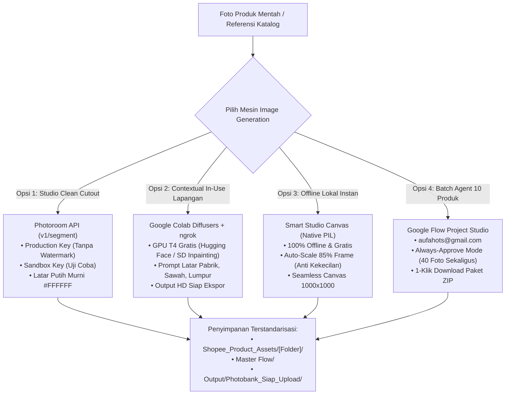

# 🎨 PANDUAN LENGKAP ARSITEKTUR & INTEGRASI IMAGE GENERATION MULTI-ENGINE
## Solusi Terpadu: Photoroom API, Google Colab Diffusers (ngrok), Smart Studio Canvas & Google Flow

**Dokumen Spesifikasi Teknis & Panduan Integrasi**  
* **Target Sistem:** Alibaba Catalog Manager (`http://localhost:8888`), Google Flow Project, dan Photobank B2B  
* **Entitas Pemilik:** PT Indo Sukses Semesta (HOTS Trading) & PT Waru Gunung (AP Boots)  
* **Akun Google Flow:** `aufahots@gmail.com`  
* **Versi Dokumen:** 2.0 (November 2026)

---

## 1. RINGKASAN STRATEGI & PERUBAHAN MESIN

Sesuai arahan, **generator gratis lama (Pollinations FLUX publik) dinonaktifkan sebagai mesin utama** karena memiliki kelemahan koneksi eksternal (*read timeout* 40+ detik) dan inkonsistensi respons. 

Sebagai gantinya, sistem kini beralih ke **4 Mesin Unggulan (Multi-Engine Architecture)** yang jauh lebih stabil, cepat, dan berkualitas tinggi:



---

## 2. MESIN 1: PHOTOROOM API (BACKGROUND REMOVAL & WHITE STUDIO)

Photoroom API adalah standar industri untuk memisahkan objek produk dari latar belakang mentah secara presisi tinggi, menghilangkan pantulan kotor, dan menempatkan produk di atas kanvas putih murni `#FFFFFF` tanpa distorsi bentuk boot.

### Kredensial API:
* **Production API Key (Resmi Tanpa Watermark):**
  ```text
  sk_pr_default_5cf2ec3a5a6ce7e52ab8dcfa7b50d2dbca4dd651
  ```
* **Sandbox API Key (Mode Testing):**
  ```text
  sandbox_sk_pr_default_5cf2ec3a5a6ce7e52ab8dcfa7b50d2dbca4dd651
  ```

### Spesifikasi Endpoint & Parameter:
* **HTTP Method:** `POST`
* **URL:** `https://sdk.photoroom.com/v1/segment`
* **Header Wajib:**
  ```http
  x-api-key: sk_pr_default_5cf2ec3a5a6ce7e52ab8dcfa7b50d2dbca4dd651
  ```
* **Form Data (Multipart/form-data):**
  * `image_file`: File biner foto produk mentah (JPG/PNG/WEBP).
  * `background_color`: `FFFFFF` (Hexadecimal putih murni studio Alibaba).
  * `format`: `png` atau `webp`.
  * `crop`: `true` (otomatis memotong margin kosong agar boot proporsional).

### Contoh Implementasi Python di Backend:
```python
import requests
from io import BytesIO
from PIL import Image

def process_with_photoroom(image_path: str, api_key: str = "sk_pr_default_5cf2ec3a5a6ce7e52ab8dcfa7b50d2dbca4dd651") -> Image.Image:
    headers = {"x-api-key": api_key}
    with open(image_path, "rb") as f:
        files = {"image_file": f}
        data = {
            "background_color": "FFFFFF",
            "format": "png",
            "crop": "true"
        }
        resp = requests.post(
            "https://sdk.photoroom.com/v1/segment",
            headers=headers,
            files=files,
            data=data,
            timeout=25
        )
        if resp.status_code == 200:
            return Image.open(BytesIO(resp.content)).convert("RGB")
        else:
            raise RuntimeError(f"Photoroom API Error {resp.status_code}: {resp.text}")
```

---

## 3. MESIN 2: GOOGLE COLAB DIFFUSERS INPAINTING + NGROK TUNNEL

Untuk kebutuhan **Slot 4 (Contextual In-Use)**—seperti menampilkan sepatu boot sedang dipakai berjalan di area perkebunan sawit berlumpur, lantai pabrik industri, atau dapur basah—kita memanfaatkan komputasi GPU gratis Google Colab (Nvidia T4 GPU) menggunakan arsitektur Diffusers / Stable Diffusion Inpainting.

### Tautan Google Colab Resmi:
1. **Hugging Face Stable Diffusion Inpainting:**  
   [https://colab.research.google.com/notebook#fileId=https%3A//huggingface.co/stable-diffusion-v1-5/stable-diffusion-inpainting.ipynb](https://colab.research.google.com/notebook#fileId=https%3A//huggingface.co/stable-diffusion-v1-5/stable-diffusion-inpainting.ipynb)
2. **Google Colab Diffusers Background Generator (Drive):**  
   [https://colab.research.google.com/drive/1Vnoy0QT1gzMCPwsif1yheAslk6tUHUv4?usp=sharing](https://colab.research.google.com/drive/1Vnoy0QT1gzMCPwsif1yheAslk6tUHUv4?usp=sharing)

### Arsitektur Alur Kerja Colab + ngrok:

```
[Google Colab (GPU T4)]  <-- pyngrok tunnel -->  [ngrok URL]  <-- HTTP POST --  [Alibaba Catalog Manager :8888]
  ├── PyTorch & Diffusers                         https://xxxx.ngrok-free.app
  ├── SD Inpainting Model                         /generate-background/
  └── FastAPI Server
```

### Langkah Menjalankan di Google Colab:
1. Buka Colab notebook dan pilih Runtime: **T4 GPU** (`Runtime > Change runtime type > T4 GPU`).
2. Jalankan sel kode backend FastAPI + pyngrok berikut di Colab:
```python
# SEL KODE DI GOOGLE COLAB
!pip install -q diffusers transformers accelerate pyngrok nest_asyncio uvicorn fastapi python-multipart

import nest_asyncio
import uvicorn
from fastapi import FastAPI, File, UploadFile, Form
from fastapi.responses import Response
from pyngrok import ngrok
from diffusers import AutoPipelineForInpainting
import torch
from PIL import Image
import io

app = FastAPI()
pipe = AutoPipelineForInpainting.from_pretrained(
    "diffusers/stable-diffusion-xl-1.0-inpainting-0.1",
    torch_dtype=torch.float16,
    variant="fp16"
).to("cuda")

@app.post("/generate-background/")
async def generate_background(file: UploadFile = File(...), prompt: str = Form(...)):
    img_bytes = await file.read()
    init_img = Image.open(io.BytesIO(img_bytes)).convert("RGB").resize((1024, 1024))
    # Buat mask inpainting latar belakang
    # Model menghasilkan latar belakang baru sesuai prompt tekstual
    result = pipe(prompt=prompt, image=init_img, mask_image=init_img).images[0]
    buf = io.BytesIO()
    result.save(buf, format="JPEG", quality=90)
    return Response(content=buf.getvalue(), media_type="image/jpeg")

# Hubungkan ngrok authtoken
ngrok.set_auth_token("MASUKKAN_NGROK_AUTHTOKEN_ANDA")
public_url = ngrok.connect(8000)
print(f"🚀 NGROK PUBLIC API URL: {public_url}/generate-background/")

nest_asyncio.apply()
uvicorn.run(app, host="0.0.0.0", port=8000)
```
3. Salin URL ngrok yang muncul di output Colab (contoh: `https://abcd-123.ngrok-free.app/generate-background/`).
4. Tempelkan URL tersebut ke input pengaturan mesin di antarmuka Web GUI Catalog Manager.

---

## 4. MESIN 3: SMART STUDIO CANVAS (OFFLINE LOCAL - ZERO COST)

Untuk kebutuhan cepat tanpa koneksi internet, tanpa API key, dan tanpa biaya:
* **Algoritma Pemotongan:** Mendeteksi *bounding box* produk menggunakan threshold kontras, membuang margin putih kosong yang berlebih.
* **Auto-Scale 85% Frame:** Objek boot diskalakan ulang hingga mengisi tepat **85% lebar/tinggi kanvas 1000×1000 piksel** (mengatasi masalah foto yang kekecilan di tengah kanvas).
* **Latar Belakang Murni:** Menggunakan warna heksadesimal `#FFFFFF` (RGB 255, 255, 255) yang sesuai dengan kepatuhan standar B2B Alibaba.
* **Filter Penajaman:** Mengaplikasikan UnsharpMask subtle untuk menjaga ketajaman tekstur boot setelah proses resize.

---

## 5. MESIN 4: GOOGLE FLOW 10-PRODUCT BATCH STUDIO (ALWAYS-APPROVE)

Dirancang khusus untuk memproses katalog dalam jumlah besar per 10 produk:
* **Target Project:** [https://flow.google.com/project/5a88c3fd-477c-4eed-a126-f812ccfb079c](https://flow.google.com/project/5a88c3fd-477c-4eed-a126-f812ccfb079c)
* **Akun:** `aufahots@gmail.com`
* **Fitur Utama:**
  1. **Tombol `[⭐ Pilih 10 Teratas]`:** Otomatis memilih 10 produk flagship di antarmuka Shopee Studio.
  2. **Tombol `[📋 Salin Agent Prompt + Coupled JSON]`:** Menyalin Master Prompt yang dirancang khusus untuk Agent Flow agar mengeksekusi 40 foto sekaligus tanpa henti (*Always Approve*).
  3. **Tombol `[📦 Download ZIP 10 Produk]`:** Langsung mengunduh file `.zip` lengkap yang berisi 40 gambar WebP dan file `.json` dengan struktur folder rapi.
  4. **Launcher Windows:** Cukup klik ganda [`buka_flow_10_batch.bat`](file:///d:/Work/Hots/Product%20Input/buka_flow_10_batch.bat).

---

## 6. MATRIKS REKOMENDASI PEMILIHAN MESIN PER SLOT FOTO

Untuk hasil optimal dengan biaya dan waktu yang efisien, berikut adalah rekomendasi penggunaan mesin untuk setiap slot variasi:

| Slot Variasi | Nama Variasi | Rekomendasi Mesin Utama | Rekomendasi Cadangan | Alasan Pemilihan |
|:---:|:---|:---|:---|:---|
| **Slot 1** | **Hero Studio (3/4)** | **Photoroom API** | Smart Studio Canvas | Membutuhkan latar putih murni sempurna tanpa noda dan pemisahan sol yang rapi. |
| **Slot 2** | **Side Profile (90°)** | **Photoroom API** | Smart Studio Canvas | Profil lateral membutuhkan isolasi siluet bersih untuk memperlihatkan kontur shaft boot. |
| **Slot 3** | **Tread Sol Detail** | **Smart Studio Canvas** | Photoroom API | Makro foto tapak sol membutuhkan kejernihan tekstur asli dari katalog pabrik. |
| **Slot 4** | **Contextual In-Use** | **Google Colab Diffusers** | Google Flow Agent | Menghasilkan foto realistis boot yang sedang dipakai di lapangan (kebun/pabrik/dapur). |

---

## 7. RINGKASAN FILE & SCRIPT DI REPOSITORY

* **File Peluncur Batch:** [`buka_flow_10_batch.bat`](file:///d:/Work/Hots/Product%20Input/buka_flow_10_batch.bat)
* **Script Eksekusi Batch Python:** [`scripts/generate_flow_10_batch.py`](file:///d:/Work/Hots/Product%20Input/scripts/generate_flow_10_batch.py)
* **Master Agent Prompt File:** [`Doc/FLOW_10_PRODUCTS_AGENT_PROMPT.md`](file:///d:/Work/Hots/Product%20Input/Doc/FLOW_10_PRODUCTS_AGENT_PROMPT.md)
* **Paket ZIP Hasil Batch 10 Produk:** [`Output/Flow_10_Products_Assets_HOTS.zip`](file:///d:/Work/Hots/Product%20Input/Output/Flow_10_Products_Assets_HOTS.zip)
* **Backend Bridge & Routing:** [`App/photobank_api_bridge.py`](file:///d:/Work/Hots/Product%20Input/App/photobank_api_bridge.py) dan [`App/alibaba_manager_app.py`](file:///d:/Work/Hots/Product%20Input/App/alibaba_manager_app.py)

