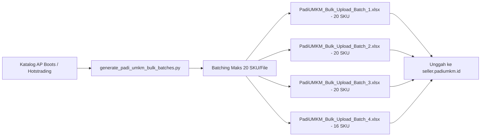

# 📘 PANDUAN LENGKAP & SPESIFIKASI BULK UPLOAD PADI UMKM 2026 (33 KOLOM)
**PT Indo Sukses Semesta — Pengadaan B2B BUMN Pasar Digital UMKM (AP Boots)**

> **Status:** Standard Master Template 2026 (Divalidasi Berdasarkan `bulk_template_master_barang.xlsx`)  
> **Target Platform:** PaDi UMKM B2B Marketplace (Pasar Digital BUMN & Pemerintah)  
> **Batasan Sistem Template:** **Maksimal 20 Produk Per File Excel**  
> **Output Batch Riil:** Tersedia 4 Batch File Excel (76 SKU AP Boots) di [`Output_PadiUMKM/`](file:///d:/Work/Hots/Product%20Input/Output_PadiUMKM)  
> **Skrip Generator:** [`Output/generate_padi_umkm_bulk_batches.py`](file:///d:/Work/Hots/Product%20Input/Output/generate_padi_umkm_bulk_batches.py)  

---

## 📑 Daftar Isi
1. [Ringkasan Eksekutif & Karakteristik Pasar PaDi UMKM](#1-ringkasan-eksekutif--karakteristik-pasar-padi-umkm)
2. [Spesifikasi Teknis 33 Kolom PaDi UMKM (Master Schema)](#2-spesifikasi-teknis-33-kolom-padi-umkm-master-schema)
3. [Regulasi Pengadaan BUMN: TKDN, PDN, & Ketentuan Pajak (PPN & PPh 22)](#3-regulasi-pengadaan-bumn-tkdn-pdn--ketentuan-pajak-ppn--pph-22)
4. [Formula Optimasi Judul B2B, Deskripsi, & Taksonomi Kategori](#4-formula-optimasi-judul-b2b-deskripsi--taksonomi-kategori)
5. [Standar Media (Foto & Video) & Prosedur Hosting PaDi UMKM](#5-standar-media-foto--video--prosedur-hosting-padi-umkm)
6. [Struktur Batch Output & Manajemen File Riil](#6-struktur-batch-output--manajemen-file-riil)
7. [Panduan Operasional Upload Langkah-demi-Langkah di Seller Center](#7-panduan-operasional-upload-langkah-demi-langkah-di-seller-center)
8. [Arsitektur Skrip Otomasi & Sinkronisasi Sistem](#8-arsitektur-skrip-otomasi--sinkronisasi-sistem)

---

## 🏛️ 1. Ringkasan Eksekutif & Karakteristik Pasar PaDi UMKM

PaDi UMKM (Pasar Digital Usaha Mikro, Kecil, dan Menengah) adalah platform ekosistem pengadaan barang dan jasa milik Kementerian BUMN Republik Indonesia yang menghubungkan vendor/seller terverifikasi dengan seluruh BUMN dan instansi pemerintah.

Berbeda dengan marketplace B2C (seperti Shopee/Tokopedia) maupun platform ekspor global (Alibaba), pengisian listing di PaDi UMKM tunduk pada regulasi ketat pengadaan nasional:



### Karakteristik & Batasan Kunci Sistem:
1. **Batas Maksimal 20 Produk:** Sheet `Isian Template Upload Barang` menyatakan secara eksplisit: *"Catatan: Anda dapat menuliskan max 20 produk pada template ini"*. Unggahan melebihi 20 baris per file akan ditolak oleh validator sistem.
2. **Kepatuhan TKDN & PDN:** Verifikasi sertifikasi Tingkat Komponen Dalam Negeri (TKDN) dan label Produk Dalam Negeri (PDN) adalah instrumen prioritas algoritma pencarian belanja instansi BUMN.
3. **Ketentuan Perpajakan Baku:** Transaksi BUMN mewajibkan transparansi perlakuan PPN (status Aktif/Non Aktif) dan pemotongan PPh Pasal 22 (`PPH 22`).
4. **Validasi Panjang Karakter yang Ketat:** Judul produk dibatasi **maksimal 70 karakter** (sangat berbeda dengan Alibaba yang mengizinkan 128 karakter), dan deskripsi wajib minimal **50 karakter**.

---

## 📋 2. Spesifikasi Teknis 33 Kolom PaDi UMKM (Master Schema)

Template resmi [`bulk_template_master_barang.xlsx`](file:///d:/Work/Hots/Product%20Input/Template/bulk_template_master_barang.xlsx) terdiri dari **33 kolom** yang didefinisikan pada Baris 3, dengan petunjuk teknis pada Baris 2.

Berikut tabel acuan lengkap spesifikasi teknis seluruh 33 kolom:

| No | Nama Kolom Excel | Kol | Status | Tipe Data & Validasi | Nilai Standar AP Boots | Keterangan & Aturan Sistem |
|---|---|:---:|:---:|---|---|---|
| **1** | `Error_Message` | A | *Abaikan* | String / Output Sistem | *(Dikosongkan)* | Jangan diisi manual. Sistem PaDi UMKM akan menulis laporan error di sini jika upload gagal. |
| **2** | `Tipe_Produk` | B | **Wajib** | Enum: `Barang`, `Jasa` | `Barang` | Default terisi pada template master barang. Wajib tetap bernilai `Barang`. |
| **3** | `Nama_Produk` | C | **Wajib** | String: **5 - 70 Karakter** | `Sepatu Boot AP Safety S5 Kuning Steel Toe` | Wajib unik per produk. Rumus: Brand + Seri + Varian Warna/Fitur. Dilarang >70 karakter. |
| **4** | `Deskripsi_Produk` | D | **Wajib** | String: **50 - 2000 Karakter** | *Teks spesifikasi lengkap* | Menjelaskan material, keunggulan, standar SNI, dan ukuran. Minimal 50 karakter! |
| **5** | `Kategori_Kode` | E | **Wajib** | Integer (Daftar Kategori) | `2450` (Safety Boots) | Kode numerik dari sheet `Daftar Kode Kategori Barang`. Jangan masukkan nama teks. |
| **6** | `Berat_Produk_gr` | F | **Wajib** | Integer: **1 - 500.000 gram** | `2700` (Safety) / `900` (Allbike) | Bobot per pasang dalam satuan gram (gr) tanpa titik/koma. |
| **7** | `Dimensi_Panjang_cm` | G | **Wajib** | Integer: Min 1 cm | `40` (Safety) / `35` (Casual) | Dimensi panjang kemasan produk dalam centimeter. |
| **8** | `Dimensi_Lebar_cm` | H | **Wajib** | Integer: Min 1 cm | `30` (Safety) / `25` (Casual) | Dimensi lebar kemasan produk dalam centimeter. |
| **9** | `Dimensi_Tinggi_cm` | I | **Wajib** | Integer: Min 1 cm | `15` (Safety) / `12` (Casual) | Dimensi tinggi kemasan produk dalam centimeter. |
| **10** | `Pembelian_Minimum` | J | **Wajib** | Integer: **1 - 9999** | `1` | Jumlah minimal order pengadaan (MOQ). |
| **11** | `Brand` | K | Rekomendasi | String: Max 70 Karakter | `AP Boots` | Merek dagang resmi terdaftar. |
| **12** | `PDN` | L | **Wajib** | Enum: `"Ya"` atau `"Tidak"` | `Ya` | Menyatakan Produk Dalam Negeri. Produk AP Boots diproduksi 100% di Indonesia. |
| **13** | `Jenis_TKDN` | M | **Wajib** | Enum: `"Sertifikasi Pihak Ketiga"` / `"Tidak Mengetahui"` | `Sertifikasi Pihak Ketiga` / `Tidak Mengetahui` | Gunakan `Sertifikasi Pihak Ketiga` jika memiliki sertifikat Kemenperin. |
| **14** | `Nilai_TKDN` | N | Kondisional | Desimal: **0.0 - 100.0** | `70.38` (Khusus AP Safety S5) | Wajib diisi jika Jenis_TKDN = `Sertifikasi Pihak Ketiga`. Masukkan angka murni tanpa `%`. |
| **15** | `Dokumen_Pendukung_TKDN` | O | Kondisional | URL Link Dokumen | Link Google Drive / CDN PDF | Wajib diisi jika Jenis_TKDN = `Sertifikasi Pihak Ketiga`. Format PDF/JPG/PNG max 5MB. |
| **16** | `Foto_Produk_1` | P | **Wajib** | Direct URL Gambar | `https://hotstrading.com/...` | Foto produk utama dengan latar belakang bersih. Wajib bisa diakses publik. |
| **17** | `Foto_Produk_2` | Q | Opsional | Direct URL Gambar | Direct URL Gambar | Foto sudut kedua / tapak sol outsole. |
| **18** | `Foto_Produk_3` | R | Opsional | Direct URL Gambar | Direct URL Gambar | Foto sudut ketiga / fleksibilitas atau detail logo. |
| **19** | `Foto_Produk_4` | S | Opsional | Direct URL Gambar | Direct URL Gambar | Foto kemasan / box produk. |
| **20** | `Foto_Produk_5` | T | Opsional | Direct URL Gambar | Direct URL Gambar | Foto galeri tambahan. |
| **21** | `URL_Video_Produk_1` | U | Opsional | URL Video | Direct URL Video | Link video demonstrasi atau spesifikasi produk. |
| **22** | `Stok_Unit` | V | **Wajib** | Integer: **1 - 9.999.999** | `100` | Jumlah unit siap kirim. Tidak ditampilkan ke pembeli umum. |
| **23** | `Satuan_Stok` | W | **Wajib** | Enum: `pcs`, `pack`, `box`, `lainnya` | `pcs` | Satuan unit dasar. Untuk sepasang sepatu, gunakan `pcs`. |
| **24** | `Nama_Satuan_Lainnya` | X | Kondisional | String | *(Dikosongkan)* | Hanya wajib diisi jika `Satuan_Stok` dipilih `lainnya` (misal: "pasang"). |
| **25** | `Stok_Selalu_Ada` | Y | **Wajib** | Enum: `"Aktif"`, `"Non Aktif"` | `Aktif` | Jika `Aktif`, sistem otomatis menjaga ketersediaan barang. |
| **26** | `Pre_Order_Duration` | Z | Opsional | Integer: **1 - 180 hari** | *(Dikosongkan)* | Durasi pre-order. Kosongkan jika produk ready stock. |
| **27** | `Harga_Satuan` | AA | **Wajib** | Angka Bulat (IDR) | `140800` (sesuai pricelist) | Harga per unit **sebelum PPN**. Tanpa simbol `Rp`, koma, atau titik. |
| **28** | `PPN` | AB | **Wajib** | Enum: `"Aktif"`, `"Non Aktif"` | `Non Aktif` | Pilih `Aktif` jika harga otomatis ditambahkan PPN saat checkout sistem. |
| **29** | `Opsi_PPh` | AC | **Wajib** | Enum: `"Tidak Dipotong"`, `"PPH 22"` | `PPH 22` | Standar BUMN untuk pengadaan barang industri/perdagangan adalah PPh Pasal 22. |
| **30** | `Asuransi_Pengiriman` | AD | **Wajib** | Enum: `"Wajib"`, `"Opsional"` | `Wajib` | Menjamin ganti rugi atas kehilangan atau kerusakan barang selama ekspedisi. |
| **31** | `Jadikan_Gratis_Ongkir` | AE | **Wajib** | Enum: `"Ya"`, `"Tidak"` | `Tidak` | Biaya pengiriman ditanggung oleh pembeli / pagu logistik BUMN. |
| **32** | `Visibilitas_Produk` | AF | **Wajib** | Enum: `"Publik"`, `"Privat"` | `Publik` | `Publik` agar dapat dicari oleh seluruh pembeli BUMN di search catalog PaDi. |
| **33** | `Kode_SKU` | AG | Opsional | Alfanumerik Unik | `APB-S5-KNG-41` | Kode SKU internal untuk mempermudah pencatatan gudang dan sinkronisasi ERP. |

---

## 🏛️ 3. Regulasi Pengadaan BUMN: TKDN, PDN, & Ketentuan Pajak

### 3.1 Produk Dalam Negeri (PDN) & Tingkat Komponen Dalam Negeri (TKDN)
Instansi BUMN diwajibkan oleh regulasi pengadaan pemerintah untuk memprioritaskan belanja produk yang memiliki nilai TKDN dan berstatus PDN:
- **PDN:** Kolom `PDN` wajib diisi **`"Ya"`** untuk seluruh produk AP Boots karena seluruh lini manufaktur dilakukan di pabrik dalam negeri Indonesia.
- **Sertifikasi TKDN:**
  - Untuk SKU yang telah diaudit resmi oleh surveyor independen (misal: PT Surveyor Indonesia / Sucofindo / Kemenperin):
    - `Jenis_TKDN`: **`"Sertifikasi Pihak Ketiga"`**
    - `Nilai_TKDN`: Persentase numerik, contoh **`70.38`** (AP Safety S5).
    - `Dokumen_Pendukung_TKDN`: Link publik sertifikat resmi (maksimal 5 MB format PDF/JPG/PNG).
  - Untuk SKU yang belum memiliki sertifikat audit terpisah:
    - `Jenis_TKDN`: **`"Tidak Mengetahui"`**
    - `Nilai_TKDN`: Kosongkan.
    - `Dokumen_Pendukung_TKDN`: Kosongkan.

### 3.2 Ketentuan Perpajakan Transaksi BUMN (PPN & PPh 22)
1. **Harga Satuan (Sebelum PPN):**
   - Nilai pada kolom `Harga_Satuan` adalah DPP (Dasar Pengenaan Pajak). Jangan mencantumkan harga yang sudah di-mark-up PPN secara manual.
2. **Status PPN (`Aktif` vs `Non Aktif`):**
   - Apabila diatur **`"Aktif"`**, sistem PaDi UMKM akan otomatis menghitung tarif PPN 11% / 12% pada faktur pajak pembeli BUMN saat proses checkout penerbitan PO (Purchase Order).
   - Apabila diatur **`"Non Aktif"`**, harga berlaku nett di portal (biasanya untuk non-PKP).
3. **Pemotongan PPh Pasal 22 (`PPH 22`):**
   - Transaksi pengadaan barang oleh instansi pemerintah dan BUMN tunduk pada pemungutan PPh Pasal 22 sebesar 1,5% bagi wajib pajak ber-NPWP. Pada kolom `Opsi_PPh`, pilihlah **`"PPH 22"`**.

---

## 🎯 4. Formula Optimasi Judul B2B, Deskripsi, & Taksonomi Kategori

### 4.1 Formula Judul Produk (Maksimal 70 Karakter)
Berbeda dengan Alibaba (128 karakter) atau marketplace B2C (255 karakter), batas judul di PaDi UMKM adalah **70 karakter**. Judul harus ringkas, jelas, dan memuat kata kunci spesifikasi teknis:

$$\text{Formula Judul} = \text{[AP Boots]} + \text{[Nama Seri]} + \text{[Warna/Fitur]} + \text{[Jenis Barang]}$$

*Contoh Penerapan Presisi (Semua di bawah 70 karakter):*
- `Sepatu Boot AP Safety S5 Kuning Steel Toe Cap Proyek` *(52 Karakter)* ✅
- `Sepatu Boot AP Terra Eco 3 Hijau Perkebunan & Pertanian` *(55 Karakter)* ✅
- `Sepatu Karet AP All Bike Hitam Merah Anti Air Outdoor` *(53 Karakter)* ✅
- `Sepatu Kerja Dapur AP Chef Hitam Anti Slip Oil Resistant` *(56 Karakter)* ✅
- `Sandal Selop Karet AP Clogs Abu Pria Tahan Air` *(46 Karakter)* ✅

> [!WARNING]
> Jangan menambahkan kata promosi seperti *"Murah"*, *"Promo Diskon"*, *"Terlaris"* atau karakter simbol khusus (`!`, `@`, `#`, `*`) karena dapat menyebabkan validasi sistem gagal.

### 4.2 Template Deskripsi Produk (50 - 2000 Karakter)
Gunakan format terstruktur teks polos (plain text dengan bullet point) yang rapi:

```text
Sepatu Boot AP Boots varian Terra Eco 3. Terbuat dari bahan PVC berkualitas tinggi, tahan air, kuat, fleksibel, dan nyaman digunakan untuk kegiatan industri, konstruksi, maupun perkebunan.

Keunggulan & Fitur Utama:
- 100% Tahan Air (Waterproof) tanpa sambungan
- Sol luar tapak tebal anti slip dan tahan minyak
- Fleksibel dan tidak mudah retak pada suhu ekstrem
- Mudah dicuci dan cepat kering

Spesifikasi & Detail Produk:
- Merek: AP Boots (Original 100%)
- Model: AP Terra Eco 3
- Bahan: Kompon PVC Murni
- Ukuran: 38 - 43
- Standar: Standar Nasional Indonesia (SNI)
- Status Produksi: 100% Produk Dalam Negeri (PDN)
```

### 4.3 Matriks Taksonomi Kode Kategori PaDi UMKM Resmi
Daftar kode kategori terverifikasi yang diambil dari sheet `Daftar Kode Kategori Barang`:

| Kode Kategori | Taksonomi Lengkap PaDi UMKM | Target Lini Produk AP Boots |
|:---:|---|---|
| **`2450`** | `Pertukangan > Alat Keselamatan > Safety Boots` | AP Safety S4, AP Safety S5, AP Metaguard |
| **`658`** | `Fashion Pria > Sepatu Pria > Boots Pria` | AP Terra (Eco, 2, 3, 5, GP), AP 2006, AP Max, AP Moto, AP Green, AP 9303 |
| **`664`** | `Fashion Pria > Sepatu Pria > Sneakers Pria` | AP All Bike, AP Star |
| **`661`** | `Fashion Pria > Sepatu Pria > Sandal Pria` | AP Clogs, AP Van Sandal, Selop Karet |
| **`663`** | `Fashion Pria > Sepatu Pria > Slip On Pria` | AP Chef (Sepatu Dapur / Hygiene Food), AP Pantofel |
| **`519`** | `Fashion Anak & Bayi > Sepatu Anak Laki-laki > Boots Anak Laki Laki` | AP Kids, AP Safari, AP 2001 W |

---

## 🖼️ 5. Standar Media (Foto & Video) & Prosedur Hosting PaDi UMKM

### 5.1 Spesifikasi Foto Produk
- **Format:** JPG, PNG, atau WebP.
- **Rasio:** Rekomendasi 1:1 (Square), resolusi minimal 800 x 800 px, disarankan 1200 x 1200 px.
- **Tampilan Foto Utama (`Foto_Produk_1`):** Latar belakang putih bersih (*white background*), produk berada di tengah bidang foto, tanpa watermark atau border mencolok.
- **Foto Tambahan (`Foto_Produk_2` s/d `5`):** Menampilkan tampak samping, sol bawah anti-slip, fitur ujung sepatu (steel toe), dan kemasan box.

### 5.2 Dua Cara Menyiapkan Link URL Gambar
1. **Opsi 1 — Menggunakan Fitur Upload Bulk Gambar PaDi UMKM (Resmi):**
   - Akses: `https://seller.padiumkm.id/gambar-bulk`
   - Klik **"Pilih File"** lalu unggah foto produk dari folder batch lokal.
   - Klik **"Copy Link"** pada dashboard dan tempelkan link URL tersebut ke kolom `Foto_Produk_1` s/d `Foto_Produk_5` pada file Excel.
2. **Opsi 2 — Menggunakan Direct CDN / Web Hosting Publik Permanen:**
   - Link langsung yang tersimpan pada server backend (contoh: `https://hotstrading.com/backend/uploads/...`).
   - Pastikan link dapat diakses secara publik tanpa login/password.

---

## 📦 6. Struktur Batch Output & Manajemen File Riil

Karena template PaDi UMKM membatasi maksimal 20 produk per unggahan, katalog 76 produk unggulan PT Indo Sukses Semesta telah dipecah secara otomatis ke dalam **4 Batch File Excel** lengkap dengan folder foto pendukungnya di directory:  
👉 **[`d:\Work\Hots\Product Input\Output_PadiUMKM/`](file:///d:/Work/Hots/Product%20Input/Output_PadiUMKM/)**

```
Output_PadiUMKM/
├── PadiUMKM_Bulk_Upload_Batch_1.xlsx    (20 Produk - AP Clogs, Allbike, Moto, Dewasa Black/White/Green)
├── PadiUMKM_Bulk_Upload_Batch_2.xlsx    (20 Produk - AP XT, 2006, Safety S4, Metaguard, Safety S5)
├── PadiUMKM_Bulk_Upload_Batch_3.xlsx    (20 Produk - AP Max, Terra Eco, Terra 5, Terra 3, Terra 2, Terra GP)
├── PadiUMKM_Bulk_Upload_Batch_4.xlsx    (16 Produk - AP Terra Army, Orca, Chef, Medic, Pantofel, Kids)
├── Batch_1_Images/                     (55 Foto siap upload ke seller.padiumkm.id/gambar-bulk)
├── Batch_2_Images/                     (54 Foto siap upload ke seller.padiumkm.id/gambar-bulk)
├── Batch_3_Images/                     (44 Foto siap upload ke seller.padiumkm.id/gambar-bulk)
└── Batch_4_Images/                     (30 Foto siap upload ke seller.padiumkm.id/gambar-bulk)
```

---

## 🚀 7. Panduan Operasional Upload Langkah-demi-Langkah di Seller Center

Ikuti tahapan berikut saat melakukan unggahan massal ke portal PaDi UMKM:

### Langkah 1: Persiapan Gambar di Portal PaDi
1. Buka browser dan login ke akun seller: **`https://seller.padiumkm.id`**.
2. Masuk ke menu **Media / Gambar Bulk**: `https://seller.padiumkm.id/gambar-bulk`.
3. Buka folder lokal [`Output_PadiUMKM/Batch_1_Images`](file:///d:/Work/Hots/Product%20Input/Output_PadiUMKM/Batch_1_Images).
4. Unggah seluruh foto produk Batch 1 sekaligus.

### Langkah 2: Mengunggah File Excel Batch
1. Masuk ke menu **Produk** > **Tambah Produk Sekaligus (Bulk Upload)**.
2. Pilih tipe unggahan: **Barang**.
3. Klik tombol **"Upload File Excel"** lalu pilih file:  
   👉 [`Output_PadiUMKM/PadiUMKM_Bulk_Upload_Batch_1.xlsx`](file:///d:/Work/Hots/Product%20Input/Output_PadiUMKM/PadiUMKM_Bulk_Upload_Batch_1.xlsx).
4. Klik **Kirim / Proses Upload**.

### Langkah 3: Verifikasi & Penanganan Error Feedback
1. Tunggu 1 - 3 menit hingga status proses berubah menjadi **Selesai** atau **Gagal Sebagian**.
2. Jika ada status gagal, unduh file laporan hasil dari portal PaDi UMKM.
3. Buka file hasil unduhan dan periksa **Kolom 1 (`Error_Message`)**:
   - *Pesan "Nama produk melebihi 70 karakter"*: Perpendek judul produk.
   - *Pesan "Deskripsi kurang dari 50 karakter"*: Tambahkan rincian spesifikasi.
   - *Pesan "Kategori kode tidak valid"*: Cocokkan kembali dengan tabel kode kategori.
   - *Pesan "Format foto tidak dapat diakses"*: Periksa apakah URL gambar berstatus publik.
4. Lakukan langkah yang sama secara berurutan untuk **Batch 2**, **Batch 3**, dan **Batch 4**.

---

## ⚙️ 8. Arsitektur Skrip Otomasi & Sinkronisasi Sistem

Proses generasi file bulk upload PaDi UMKM didukung oleh skrip otomasi Python terintegrasi:

- **File Skrip:** [`Output/generate_padi_umkm_bulk_batches.py`](file:///d:/Work/Hots/Product%20Input/Output/generate_padi_umkm_bulk_batches.py)
- **Sumber Data Input:**
  1. `PRICE LIST NEW AP Boots (Internal) (1).xlsx` — Sumber data SKU, varian, dan harga resmi IDR.
  2. `hotj4796_hotstrading (4).sql` — Basis data produk dan link foto resolusi tinggi.
  3. `bulk_template_master_barang.xlsx` — Template resmi PaDi UMKM sebagai basis pemetaan.
- **Logika Otomasi:**
  - Auto-cleaning karakter nama produk agar tepat $\le 70$ karakter.
  - Auto-padding deskripsi spesifikasi agar memenuhi batas minimal 50 karakter dan $\le 2000$ karakter.
  - Auto-mapping kode kategori numerik (Safety = `2450`, Boots = `658`, Sandal = `661`, dll.).
  - Penandaan khusus TKDN & link sertifikat dokumen pendukung untuk lini *AP Safety S5*.
  - Pemotongan dataset ke dalam sub-file Excel per 20 produk secara otomatis.

---
*Dokumen ini merupakan panduan baku operasional listing PaDi UMKM PT Indo Sukses Semesta untuk menjamin keberhasilan unggah massal dan kepatuhan terhadap regulasi pengadaan BUMN 2026.*
