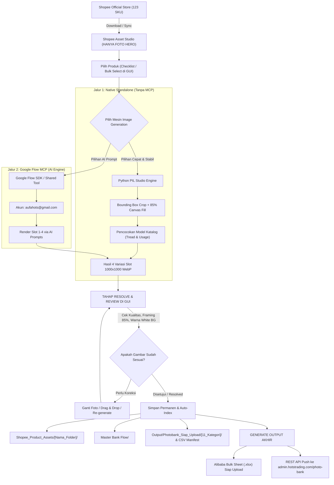

# 📘 PANDUAN LENGKAP WORKFLOW IMAGE GENERATION (NATIVE VS MCP), TAHAP RESOLVE/REVIEW, HINGGA EKSPOR EXCEL ALIBABA

**Dokumen Standar Operasional Prosedur (SOP) & Arsitektur Teknis**  
**Project:** Alibaba & Photobank Catalog Manager  
**Legal Manufacturer:** PT Waru Gunung  
**Export Operator:** PT Indo Sukses Semesta  
**Target Platform:** Alibaba B2B, Shopee Official, & Photobank (`admin.hotstrading.com/photo-bank`)  

---

## 1. RINGKASAN & PENEGASAN ALUR KERJA UTAMA

Berdasarkan kebutuhan operasional terbaru:
1. **Shopee Official Asset Studio Hanya Memiliki 1 Foto Resmi (Hero Image):**
   * Data resmi dari official store Shopee hanya menyediakan 1 foto tampak depan/3-quarter (`hero_[nama].webp`).
   * Foto samping (*side image*) sebelumnya yang keliru telah **dihapus dari Shopee Asset Studio**.
   * Dari 1 foto Hero resmi inilah sistem lokal akan memproduksi 4 variasi slot untuk kebutuhan Photobank & Alibaba B2B.
2. **Dua Pilihan Mesin Image Generation:**
   * **Mode A: Native Standalone Engine (Tanpa MCP - Rekomendasi Utama):**
     * 100% berjalan lokal di Python (`App/photobank_api_bridge.py`).
     * Memotong kelebihan padding putih (*bounding box detection*), melakukan *upscale* berkualitas tinggi (*Lanczos Resampling + Unsharp Mask*), sehingga sepatu **mengisi 85% bingkai kanvas 1000×1000 px** berlatar putih `#FFFFFF` murni (tidak kekecilan).
     * Sangat cepat, stabil, tanpa dependensi server eksternal, dan berjalan instan.
   * **Mode B: Google Flow AI / MCP Engine (`aufahots@gmail.com`):**
     * Menghubungkan prompt produk ke Google Flow Project (`5a88c3fd-477c-4eed-a126-f812ccfb079c`) melalui Flow SDK atau remote automation untuk menghasilkan variasi fotorealistis AI.
3. **Tahap "Resolve & Review" Sebelum Upload:**
   * Foto hasil generate harus ditinjau (*preview*) secara visual di Web GUI terlebih dahulu untuk memastikan resolusi tajam, rasio kanvas 1:1, dan framing 85%.
4. **Tahap Ekspor ke Excel Alibaba & Sinkronisasi Photobank:**
   * Setelah foto di-resolve, sistem mengaitkan path foto ke file JSON produk dan mengonversinya ke file **Alibaba Bulk Sheet (.xlsx)** siap impor, serta mendaftarkannya ke folder 11 kategori Photobank dan manifest CSV.

---

## 2. DIAGRAM ALUR END-TO-END



---

## 3. PENJELASAN TEKNIS: JIKA MENGGUNAKAN MCP

Jika Anda ingin menggunakan **MCP (Model Context Protocol)** untuk Google Flow:

### A. Mengapa Sandbox Browser Menolak Selenium?
* Google Flow Tools (`https://flow.google.com/shared/tool/...`) berjalan di dalam sandbox `<iframe>` React murni di peramban klien.
* Sandbox browser memiliki batasan keamanan ketat (*Content Security Policy*) yang melarang pemanggilan proses sistem operasi seperti `chromedriver.exe` atau socket lokal Selenium.

### B. Cara Kerja yang Benar dengan MCP:
1. **Arsitektur Eksternal (Local MCP Bridge):**
   * File: [`run_flow_photobank.py`](file:///d:/Work/Hots/Product%20Input/run_flow_photobank.py) dan [`setup_flow_mcp.bat`](file:///d:/Work/Hots/Product%20Input/setup_flow_mcp.bat).
   * Script ini berjalan di luar browser (di terminal Windows Anda) menggunakan Chrome Remote Debugging port (`9222`).
   * Browser Chrome lokal dibuka dengan profil akun **`aufahots@gmail.com`**.
   * MCP server bertindak sebagai jembatan yang mengirimkan prompt dan gambar referensi langsung ke tab Google Flow yang sedang terbuka.
2. **Arsitektur Internal (Flow Tool React TypeScript App):**
   * File: [`Flow_Tool_React_App/FlowImageGeneratorTool.tsx`](file:///d:/Work/Hots/Product%20Input/Flow_Tool_React_App/FlowImageGeneratorTool.tsx).
   * Ditempelkan langsung di dalam editor Google Flow Tool.
   * Memanggil fungsi bawaan `window.Flow.generate.image({ prompt, referenceImage, aspectRatio: "1:1" })`.
   * Menghasilkan gambar langsung di dalam canvas browser tanpa membutuhkan Selenium sama sekali.

---

## 4. TAHAP "RESOLVE & REVIEW" SEBELUM UPLOAD

Sebelum gambar diunggah ke server atau dikonversi ke Excel, gambar harus melalui tahap verifikasi (*Resolve*):

### Checklist Validasi Foto (Resolve Checklist):
1. **Format & Ekstensi:** Harus berekstensi `.webp` (kualitas kompresi 90–92).
2. **Rasio & Resolusi:** Rasio tepat **1:1 Square** dengan ukuran minimal **1000 × 1000 px** (atau 1200 / 1600 px).
3. **Latar Belakang (*Background*):** 
   * Slot 1, 2, dan 3 **WAJIB** berlatar belakang putih bersih seamless (`#FFFFFF` murni / RGB 255, 255, 255).
   * Tidak boleh ada artefak abu-abu atau bayangan kotor di pinggir bingkai.
4. **Proporsi Objek (*Framing Ratio*):**
   * Objek sepatu boot harus **mengisi 82% – 85% area kanvas** (tidak boleh terlalu kecil seperti prangko dan tidak boleh terpotong di tepi).
5. **Kesesuaian 4 Slot:**
   * **Slot 1 (Hero):** Sudut 3/4 tampak depan studio.
   * **Slot 2 (Side):** Profil lateral murni 90° (memperlihatkan tinggi shaft leher boot dan tebal sol).
   * **Slot 3 (Tread):** Tapak sol bawah memperlihatkan alur anti-slip dan cleat bergerigi.
   * **Slot 4 (Contextual):** Tampak pemakaian di tanah perkebunan/pertanian atau pabrik (framing lutut ke bawah).

### Cara Me-review di Web GUI:
* Buka Web GUI (`start.bat` -> `http://localhost:8888`).
* Masuk ke tab **Shopee Official Asset Studio**.
* Klik tombol **`[⚡ Buat Image Gen]`** atau tombol **`[🌐 Flow Studio]`** pada kartu produk.
* Preview visual ke-4 slot akan langsung terlihat. Anda bisa klik gambar untuk memperbesar resolusi aslinya.
* Jika ada gambar yang kurang memuaskan, Anda cukup men-drag foto pengganti ke kotak dropzone kartu produk tersebut.

---

## 5. TAHAP KONVERSI KE EXCEL ALIBABA BULK UPLOAD (`.xlsx`)

Setelah gambar ter-resolve dan tersimpan di folder lokal:

1. **Pemetaan Nama File Standar B2B:**
   Setiap gambar diberi nama otomatis yang terstruktur:
   * Slot 1: `[SKU]_[Nama_Produk]_slot_1_hero.webp`
   * Slot 2: `[SKU]_[Nama_Produk]_slot_2_side.webp`
   * Slot 3: `[SKU]_[Nama_Produk]_slot_3_tread.webp`
   * Slot 4: `[SKU]_[Nama_Produk]_slot_4_usage.webp`
2. **Kompilasi Metadata ke JSON:**
   Metadata spesifikasi produk diperbarui secara otomatis di `Shopee_Product_Assets/[Folder]/[Folder].json`:
   * Kepatuhan GPSR Pabrikan: **PT Waru Gunung** (Surabaya, Indonesia).
   * Eksportir Resmi: **PT Indo Sukses Semesta**.
   * Daftar URL / path gambar ter-resolve untuk slot 1 hingga 4.
3. **Generate File Excel Alibaba:**
   * Di Web GUI, klik tombol **`Export Center`** -> **`Export to Excel (.xlsx)`** atau tombol centang terpilih.
   * Sistem akan mengonversi baris produk menjadi tabel standar template unggah massal Alibaba (*Alibaba Product Bulk Upload Template*):
     * Kolom `Product Name`: Format SEO B2B Bahasa Inggris (contoh: *AP Boots XTR Black Waterproof PVC Work Boots with Self-Cleaning Mud Tread for Agriculture Plantation*).
     * Kolom `Category`: Kategori resmi footwear B2B.
     * Kolom `Image URLs / Image Names`: Mengarahkan ke file gambar 4-slot yang telah di-resolve.
     * Kolom `Price USD` & `MOQ`: Dihitung otomatis berdasarkan Kurs Live Google Forex terkini.

---

## 6. SINKRONISASI KE ADMIN PHOTOBANK (`admin.hotstrading.com`)

Untuk mengunggah gambar ke website tanpa risiko FTP mentah:
1. **Gunakan Tombol "Uji Coba Upload API (Simulasi)":**
   * Di dalam modal studio, klik tombol biru `🧪 Uji Coba Upload API (Simulasi)`.
   * Sistem akan memverifikasi integritas file dan payload multipart tanpa mengubah database live.
2. **Push Live via REST API:**
   * Klik tombol ungu `🚀 Push API ke Admin Photobank`.
   * Endpoint `https://admin.hotstrading.com/api/photobank/upload` akan menerima file dan memasukkannya langsung ke kategori yang tepat (`01_Safety_Boots` s/d `11_General_Lifestyle_Boots`).
3. **Pembaruan Manifest Otomatis:**
   * File [`Output/Photobank_Siap_Upload/DAFTAR_FOTO_DAN_KATEGORI_PHOTOBANK.csv`](file:///d:/Work/Hots/Product%20Input/Output/Photobank_Siap_Upload/DAFTAR_FOTO_DAN_KATEGORI_PHOTOBANK.csv) akan otomatis mencatat entri baru lengkap dengan ukuran file (KB), nama file baru, dan grup kategori.

---

## 7. CARA MENJALANKAN APLIKASI (QUICK LAUNCH)

Cukup klik ganda file launcher di folder utama:
```bat
start.bat
```
Server lokal akan aktif di `http://localhost:8888` dan peramban web akan terbuka otomatis.
