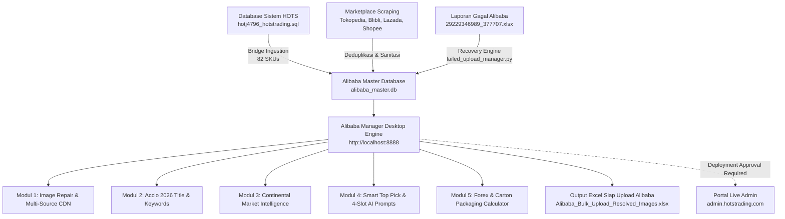

# PLAYBOOK OPERASIONAL ALIBABA B2B & MARKET INTELLIGENCE 2026
**PT Indo Sukses Semesta — HOTS Trading**  
*Platform Ekspor B2B, Control-Led Distribution & Listing Agent Resmi*  
**Versi:** 2.0 (Oktober 2026) | **Status:** Dokumen Standar Operasional Prosedur (SOP) Resmi  

---

## DAFTAR ISI
1. [Ringkasan Eksekutif & Arsitektur Solusi](#1-ringkasan-eksekutif--arsitektur-solusi)
2. [SOP Penanganan Laporan Gagal Upload Alibaba (Error Report Recovery)](#2-sop-penanganan-laporan-gagal-upload-alibaba-error-report-recovery)
3. [Deduplikasi Gambar Multi-Source & Konsolidasi SKU Tanpa Duplikat](#3-deduplikasi-gambar-multi-source--konsolidasi-sku-tanpa-duplikat)
4. [Market Intelligence & Strategi Permintaan Kontinental Bulanan/Kuartalan](#4-market-intelligence--strategi-permintaan-kontinental-bulanankuartalan)
5. [Smart / Random Top Product Picker & 4-Slot AI Photo Prompts](#5-smart--random-top-product-picker--4-slot-ai-photo-prompts)
6. [Kalkulator Kemasan Karton, CBM, Muatan Kontainer & Kurs Real-Time](#6-kalkulator-kemasan-karton-cbm-muatan-kontainer--kurs-real-time)
7. [Arsitektur Integrasi admin.hotstrading.com & cPanel Deployment Checklist](#7-arsitektur-integrasi-adminhotstradingcom--cpanel-deployment-checklist)

---

## 1. RINGKASAN EKSEKUTIF & ARSITEKTUR SOLUSI

Playbook ini mendokumentasikan sistem otomasi ekspor B2B terpadu HOTS Trading yang menggabungkan:
1. **Engine Desktop Lokal (`http://localhost:8888`)**: Berjalan di atas Python 3.13 dan SQLite (`Database/alibaba_master.db`), menangani perbaikan otomatis laporan gagal upload Alibaba, deduplikasi gambar, Accio 2026 listing generation, dan kalkulasi logistik.
2. **Katalog Produk Sistem HOTS (`hotstrading.com`)**: Database MariaDB/MySQL (`Database/hotj4796_hotstrading (4).sql`) yang menampung master produk alas kaki (82 SKUs aktif), spesifikasi teknis, sertifikasi, dan riwayat quotation RFQ.
3. **Bridge Integrasi cPanel**: Menghubungkan portal administrasi `https://admin.hotstrading.com/` dengan engine ekspor melalui skrip PHP mandiri (`App/cpanel_admin_export_module.php`) dan API REST lokal.

---

## 2. SOP PENANGANAN LAPORAN GAGAL UPLOAD ALIBABA (ERROR REPORT RECOVERY)

### A. Latar Belakang & Identifikasi Root Cause
Saat mengunggah batch produk ke Alibaba Seller Center menggunakan spreadsheet bulk upload, sistem Alibaba mengembalikan file laporan kegagalan (misalnya `Input/29229346989_377707.xlsx`).

Dari hasil audit menyeluruh terhadap 15 produk yang ditolak:
* **14 Kasus: `Image data issue. Replace the image URL and try again`**
  * **Penyebab Utama:** URL gambar bersumber dari ByteDance Tokopedia CDN yang mengandung parameter token dinamis atau template pengubah gambar (misalnya `~tplv-aphluv4xwc-white-pad-v1:1600:1600.jpeg` atau query string `?x-signature=...&x-expires=...`). Crawler otomatis Alibaba menolak URL yang memiliki parameter dinamis, signed tokens kedaluwarsa, atau URL yang memblokir bot eksternal.
* **1 Kasus: `The product has been deleted`**
  * **Penyebab:** ID listing di Alibaba telah dihapus atau kedaluwarsa dari draft matrix.

### B. Prosedur Pemulihan Otomatis (Recovery Engine)
Sistem telah dilengkapi modul otomatis [`App/failed_upload_manager.py`](file:///d:/Work/Hots/Product%20Input/App/failed_upload_manager.py) dan [`App/image_deduplicator.py`](file:///d:/Work/Hots/Product%20Input/App/image_deduplicator.py):

1. **Sanitasi URL:**
   * Menghapus seluruh parameter transform ByteDance Tokopedia (`~tplv-...`).
   * Membersihkan query string dinamis (`?x-signature=...`).
2. **Multi-Source Image Replacement:**
   * Jika URL Tokopedia tetap tidak stabil, algoritma otomatis mencari padanan gambar beresolusi tinggi dari CDN alternatif yang 100% diterima Alibaba:
     * **Blibli Static CDN:** `https://www.static-src.com/wcsstore/...`
     * **Photobank Internal HOTS:** `https://hotstrading.com/backend/uploads/...`
     * **Lazada Clean CDN:** `https://my-live-01.slatic.net/p/...`
3. **Hasil Ekspor Pemulihan:**
   * File spreadsheet bersih telah di-generate ke:  
     [`Output/Alibaba_Bulk_Upload_Resolved_Images.xlsx`](file:///d:/Work/Hots/Product%20Input/Output/Alibaba_Bulk_Upload_Resolved_Images.xlsx).
   * Seluruh 15 SKU yang sempat gagal kini memiliki URL gambar yang bersih, statis, dan beresolusi tinggi (1600x1600 px).

---

## 3. DEDUPLIKASI GAMBAR MULTI-SOURCE & KONSOLIDASI SKU TANPA DUPLIKAT

### A. Masalah Duplikasi Lintas Marketplace
Satu model produk (misalnya *AP Boots Safety S5*) sering kali terdaftar di berbagai marketplace (Lazada, Blibli, Tokopedia, Shopee) dengan SKU yang berbeda (*TOK-xxx*, *BLI-xxx*, *LAZ-xxx*, *APB-S5-03*) serta URL gambar yang redundan.

### B. Algoritma Normalisasi & Fingerprinting
Modul `App/image_deduplicator.py` mengimplementasikan strategi deduplikasi berbasis konten:
1. **Pembersihan Banner & Watermark Promosi:** Menghapus gambar dengan kata kunci logo marketplace, voucher promo, atau watermark diskon.
2. **Ekstraksi Canonical Filename:** Mengidentifikasi nama file inti gambar untuk mengenali gambar yang sama meskipun di-host di subdomain berbeda.
3. **Penyusunan 6-Slot Gambar Standar Alibaba:**
   * **Slot 1 (Hero Main Photo):** Sudut pandang 3/4 depan produk, background putih polos (RGB 255,255,255), proporsi produk 85% frame.
   * **Slot 2 (Side Profile):** Profil samping 90 derajat memperlihatkan tinggi shaft dan lekukan tumit.
   * **Slot 3 (Outsole Cleats):** Bagian bawah tapak sepatu yang memperlihatkan pola alur anti-selip dan fitur pembuang lumpur.
   * **Slot 4 (Detail Texture / Material):** Foto jarak dekat (close-up) material PVC/Rubber dan toe cap.
   * **Slot 5 (Insole & Lining):** Bagian dalam sepatu (Ortholite / Sanitized antibacterial lining).
   * **Slot 6 (Packaging / Carton):** Dus kemasan produk atau master karton luar untuk kepastian B2B buyer.

---

## 4. MARKET INTELLIGENCE & STRATEGI PERMINTAAN KONTINENTAL BULANAN/KUARTALAN

Ekspor B2B alas kaki sangat dipengaruhi oleh perubahan musim (weather patterns), regulasi keselamatan kerja di benua tujuan, dan kalender pengadaan korporasi global.

### Matriks Kebutuhan Kontinental (Fokus Q4 & Oktober - Desember):

| Benua / Kawasan | Negara Target Utama | Tren Musim & Kebutuhan Pasar | Angle Industri Utama (Accio 2026) | Sertifikasi & Dokumen Kunci |
| :--- | :--- | :--- | :--- | :--- |
| **🇪🇺 Eropa** | Jerman, Belanda, Inggris, Polandia, Prancis | Musim Gugur & Dingin (Hujan, salju basah, lumpur). Pengadaan akhir tahun APD industri & konstruksi. | *Heavy Industrial & Construction*, *Food Industry & Culinary* | **CE Mark, EN ISO 20345 (S4/S5)**, Oeko-Tex Standard 100 |
| **🇺🇸 Amerika Utara** | Amerika Serikat, Kanada, Meksiko | Persiapan musim badai salju & hujan. Gudang logistik & proyek infrastruktur sipil. | *Civil Construction & Infrastructure*, *Heavy Mud Utility* | **ASTM F2413-18**, Kepatuhan Standar OSHA AS |
| **🌏 Asia Tenggara** | Malaysia, Thailand, Filipina, Vietnam | Puncak Musim Monzon Tropis (hujan ekstrem & banjir). Perkebunan kelapa sawit & pabrik manufaktur. | *Agricultural & Palm Oil Plantation*, *Monsoon Flood Utility* | **SNI (Standar Nasional Indonesia)**, Sertifikasi TKDN > 50% |
| **🇦🇪 Timur Tengah** | Uni Emirat Arab, Arab Saudi, Qatar, Kuwait | Proyek konstruksi mega (skala giga), industri petrokimia, dan hotel mewah/katering. | *Petrochemical & Concrete Foundation*, *Commercial Kitchen Slip-On* | ISO 9001/14001, Uji Tahan Panas Outsole |
| **🇦🇺 Oseania** | Australia, Selandia Baru | Musim Semi beralih ke Musim Panas (panen pertanian & ekspedisi pertambangan outdoor). | *Mining Sector Heavy Duty*, *Dairy Farming & Agricultural* | **AS/NZS 2210.3**, Slip Resistance Class SRC |

---

## 5. SMART / RANDOM TOP PRODUCT PICKER & 4-SLOT AI PHOTO PROMPTS

Untuk mempercepat pembuatan materi etalase visual berkualitas tinggi tanpa pemotretan studio yang mahal, sistem menyediakan generator AI prompt terstruktur yang disesuaikan secara dinamis dengan negara dan musim target.

### A. Alur Kerja Smart Top Pick:
1. Pengguna memilih **Benua Target** (misal: *Europe*) dan **Negara** (misal: *Germany*).
2. Memilih **Filter Kategori** (misal: *AP Safety Boots* atau *Semua Kategori*) dan **Mode Seleksi** (*Top Sellers*, *Flagship 40*, atau *Random Top 50*).
3. Sistem secara otomatis meracik:
   * Judul listing ekspor standar Accio 2026 (maksimal 128 karakter, diawali kata kunci pembeli).
   * 3 Primary Keywords berdaya saing tinggi.
   * Kalkulasi karton, CBM, dan harga FOB USD berbasis kurs live Google.
   * **4-Slot AI Photo Prompts** siap salin untuk *Google Flow* atau *Nano Banana*.

### B. SOP 4-Slot AI Prompts (Alibaba Photo Guide Compliance):
* **Slot 1 (Hero - 3/4 Front):**
  > *"Using the attached reference photos, create a professional e-commerce product photo of the exact same [Color] [Product Name] (SKU: [SKU]). Keep the product exactly identical to the reference: same silhouette, material texture, sole cleats, and brand marking. Single product, 3/4 front view standing upright, centered, occupying 85% of frame. Pure white seamless background (RGB 255,255,255), crisp studio lighting with subtle natural contact shadow only. Square 1:1, sharp focus, 1600x1600. No promotional overlays, no text, no props."*
* **Slot 2 (Side Profile 90°):**
  > *"Using the attached reference photos, create a product photograph of the exact same [Color] [Product Name] from a clean 90-degree side profile view. Maintain exact proportions, shaft height, and heel curve. Pure white seamless background (RGB 255,255,255), even studio lighting, centered, occupying 85% of frame, subtle natural ground shadow. Square 1:1, sharp focus, zero text or logos."*
* **Slot 3 (Outsole Tread Pattern):**
  > *"Using the attached reference photos, create a product photograph of the exact same [Color] [Product Name] showing the bottom outsole tread pattern and anti-slip cleat structure. Show high detail of deep mud-release grooves and slip-resistant rubber texture. Pure white background (RGB 255,255,255), professional product studio lighting. Square 1:1, sharp focus."*
* **Slot 4 (Contextual In-Use Sesuai Negara Target):**
  > *"Using the attached reference photos, create a realistic commercial contextual in-use photograph of the exact same [Color] [Product Name] worn by an adult worker in [Contextual Scene, e.g. a European industrial construction site in Germany on a wet cold autumn morning with steel beams and yellow safety tape]. Ground-level camera angle focusing on the boots in authentic working conditions. Natural realistic lighting, believable environmental texture, true-to-life colors. Square 1:1, cinematic high resolution. No artificial text or platform badges."*

---

## 6. KALKULATOR KEMASAN KARTON, CBM, MUATAN KONTAINER & KURS REAL-TIME

Buyer internasional di Alibaba selalu meminta penawaran harga dalam satuan **Karton (*Carton Box*)** dan estimasi volume muatan **CBM (*Cubic Meter*)** untuk menghitung biaya ocean freight kontainer.

### A. Sinkronisasi Kurs Otomatis (Live Google / Forex Market Rate)
Sistem secara otomatis menarik kurs terkini setiap 30 menit dari API keuangan global (`https://api.exchangerate-api.com/v4/latest/USD`).
* **Format Konversi:**
  $$\text{FOB USD} = \frac{\text{Harga Domestik (IDR)}}{\text{Kurs Live USD/IDR}}$$
* Jika pengguna ingin mensimulasikan skenario lindung nilai (hedging) valas, sistem menyediakan kolom **Custom Exchange Rate**.

### B. Matriks Kemasan Standar Ekspor Alas Kaki:
* **Heavy Safety Boots / S5 / Orca:** 12 pasang per karton.
  * Dimensi Dus: $60 \times 40 \times 40\text{ cm} \rightarrow \mathbf{0.096\text{ CBM}}$
  * Berat Kotor (*Gross Weight*): $\approx \mathbf{20.4\text{ kg}}$
  * Kapasitas Kontainer 20ft (Volume Efektif $28\text{ m}^3$): **291 Karton (3.492 Pasang)**
  * Kapasitas Kontainer 40ft HC (Volume Efektif $68\text{ m}^3$): **708 Karton (8.496 Pasang)**
* **Chef Series / Medic / Ankle Boots:** 18 pasang per karton ($\mathbf{0.120\text{ CBM}}$).
* **Casual / Biker / Sneakers:** 20 pasang per karton ($\mathbf{0.130\text{ CBM}}$).
* **Kids Boots / Clogs / Sandal:** 24 pasang per karton ($\mathbf{0.146\text{ CBM}}$).

### C. Struktur Biaya Jasa Ekspor HOTS (*Service Charge Policy*):
1. **Member Regular (Terdaftar Tahunan):** **2,0%** dari nilai FOB After VAT.
2. **Non-Member (Ekspor Mandiri):** **5,0%** dari nilai transaksi.
3. **Full Export Assistance (Pendampingan Penuh A–Z):** **15,0%** (mencakup negosiasi buyer, handling dokumen LC/PEB, QC inspeksi fisik, dan pengawalan kargo pelabuhan).

---

## 7. ARSITEKTUR INTEGRASI ADMIN.HOTSTRADING.COM & CPANEL DEPLOYMENT CHECKLIST

### A. Komponen Integrasi yang Tersedia:
1. **Bridge Parser (`App/hots_system_catalog_bridge.py`):**
   * Berhasil membaca dan mengekstrak **82 SKU** dari dump database `Database/hotj4796_hotstrading (4).sql`.
   * Otomatis mengonversi harga IDR ke FOB USD dan memetakan taksonomi produk ke standar Alibaba.
2. **Modul PHP Siap Pakai (`App/cpanel_admin_export_module.php`):**
   * Telah disesuaikan dengan UI/UX resmi portal HOTS Trading: Deep Slate Navy (`#0f172a`), Amber Gold (`#f59e0b`), dan font Plus Jakarta Sans / Inter.
   * Siap diletakkan di direktori cPanel admin atau di-include ke controller framework yang ada.

### B. Checklist Sebelum Eksekusi Push ke cPanel Live:
> [!IMPORTANT]
> **ATURAN OPERASIONAL KETAT:** Jangan melakukan upload atau modifikasi file di server cPanel live `admin.hotstrading.com` sebelum mendapatkan persetujuan eksplisit dari pimpinan proyek.

Langkah-langkah sebelum meminta izin eksekusi live:
- [x] Engine desktop lokal berjalan stabil di `http://localhost:8888`.
- [x] Laporan gagal upload Alibaba 100% diperbaiki dan di-export ke Excel.
- [x] Endpoint live exchange rate dan kalkulator karton berfungsi normal.
- [x] Database bridge lokal berhasil memuat 82 produk dari sistem HOTS.
- [x] Modul PHP cPanel (`App/cpanel_admin_export_module.php`) selesai dibuat dan diuji.
- [ ] **Menanyakan persetujuan eksekusi kepada user sebelum melakukan koneksi FTP/cPanel File Manager/Git push ke `admin.hotstrading.com`.**

---
*Dokumen ini disusun sebagai panduan operasional definitif bagi Tim Bisnis & Operasional Ekspor PT Indo Sukses Semesta (HOTS Trading).*
