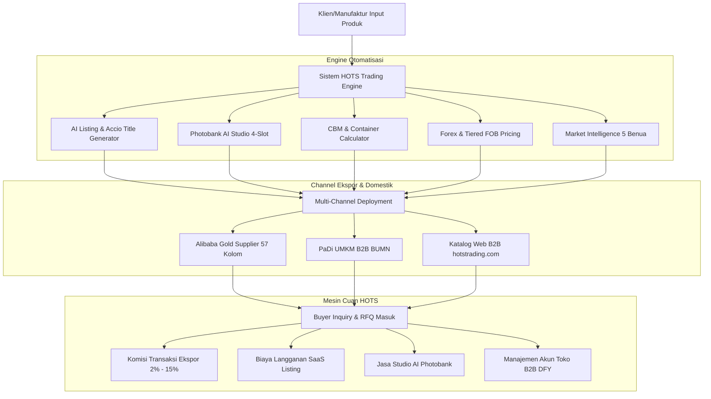
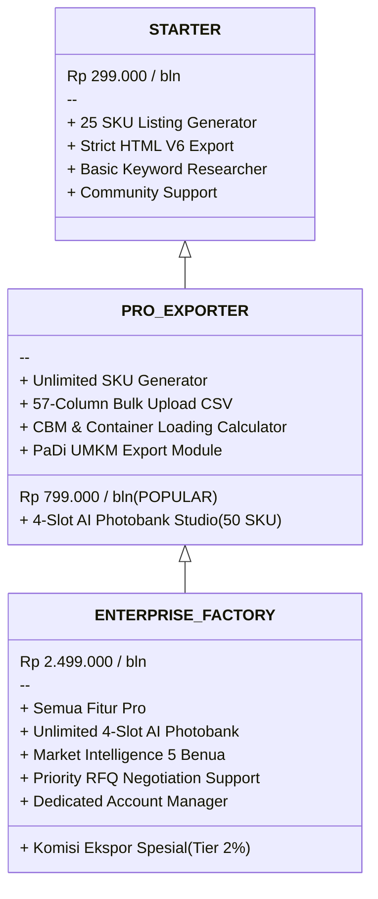

# 💰 BLUEPRINT FITUR ENGINE & MONETISASI WEBSITE (HOTS TRADING)
**Platform Ekspor B2B, AI Listing Engine, Photobank Studio & Logistik Terpadu**  
*Dokumen Rencana Fitur Website & Strategi Monetisasi (Mesin Cuan)*  
**Versi:** 1.0 (Oktober 2026) | **Target Web:** `hotstrading.com` / `admin.hotstrading.com`

---

## 📌 DAFTAR ISI
1. [Executive Summary: Mengapa Sistem Ini Mesin Cuan?](#1-executive-summary-mengapa-sistem-ini-mesin-cuan)
2. [Arsitektur Sistem & Alur Bisnis B2B](#2-arsitektur-sistem--alur-bisnis-b2b)
3. [Daftar Fitur Unggulan (Core Features) untuk Website](#3-daftar-fitur-unggulan-core-features-untuk-website)
   - [Fitur 1: Alibaba Listing Generator Master Prompt (Accio 2026 Ready)](#fitur-1-alibaba-listing-generator-master-prompt-accio-2026-ready)
   - [Fitur 2: Description Builder V6 Strict HTML Engine](#fitur-2-description-builder-v6-strict-html-engine)
   - [Fitur 3: 4-Slot AI Photobank Studio (0-Credit Flow Automation)](#fitur-3-4-slot-ai-photobank-studio-0-credit-flow-automation)
   - [Fitur 4: Direct 57-Column Alibaba Bulk Upload Generator](#fitur-4-direct-57-column-alibaba-bulk-upload-generator)
   - [Fitur 5: PaDi UMKM B2B BUMN Ingestion Engine](#fitur-5-padi-umkm-b2b-bumn-ingestion-engine)
   - [Fitur 6: Error Recovery & Multi-Source Image Deduplication](#fitur-6-error-recovery--multi-source-image-deduplication)
   - [Fitur 7: Kalkulator CBM Kemasan, Kontainer 20ft/40ft & Pallet](#fitur-7-kalkulator-cbm-kemasan-kontainer-20ft40ft--pallet)
   - [Fitur 8: Live Forex Engine & Tiered FOB Pricing](#fitur-8-live-forex-engine--tiered-fob-pricing)
   - [Fitur 9: Global Market Intelligence 5 Benua & 10 Vertikal Accio](#fitur-9-global-market-intelligence-5-benua--10-vertikal-accio)
   - [Fitur 10: Smart Top Pick Picker & Product Matchmaker](#fitur-10-smart-top-pick-picker--product-matchmaker)
4. [Model Monetisasi & Aliran Pendapatan (Revenue Streams / Cuan)](#4-model-monetisasi--aliran-pendapatan-revenue-streams--cuan)
   - [Model A: Ekspor Konsolidasi & Transaction Fee (2% - 15%)](#model-a-ekspor-konsolidasi--transaction-fee-2---15)
   - [Model B: B2B SaaS Listing & Content Subscription](#model-b-b2b-saas-listing--content-subscription)
   - [Model C: AI Photobank as a Service (Studio Foto Virtual)](#model-c-ai-photobank-as-a-service-studio-foto-virtual)
   - [Model D: Done-For-You (DFY) Store Onboarding & Management](#model-d-done-for-you-dfy-store-onboarding--management)
   - [Model E: Market Intelligence & Buyer Matchmaking Report](#model-e-market-intelligence--buyer-matchmaking-report)
5. [Skema Paket Harga & Pricing Tiers di Website](#5-skema-paket-harga--pricing-tiers-di-website)
6. [Roadmap Integrasi & Tampilan Web UI](#6-roadmap-integrasi--tampilan-web-ui)

---

## 1. EXECUTIVE SUMMARY: MENGAPA SISTEM INI MESIN CUAN?

Banyak produsen dan UMKM manufaktur Indonesia memiliki produk fisik berkualitas tinggi (misalnya **AP Boots** dengan sertifikasi SNI, ISO, dan standar ekspor), namun **gagal menembus pasar global** karena hambatan digital:
1. **Listing Alibaba tidak teroptimasi:** Skor informasi produk (PIS) rendah, ranking tenggelam oleh supplier luar negeri, format HTML ditolak Alibaba V6.
2. **Ketiadaan Aset Foto B2B Profesional:** Sewa studio foto komersial mahal, tidak punya foto teknis 4-sudut (tapak sol, profil samping, foto in-use industri).
3. **Ketidaktahuan Regulasi Ekspor & Sertifikasi:** Bingung menentukan HS Code, perhitungan CBM kontainer, dan regulasi sertifikasi negara tujuan (CE, ASTM, SASO).
4. **Kesulitan Bulk Upload:** Mengisi template 57 kolom Alibaba atau PaDi UMKM secara manual membutuhkan ratusan jam kerja dan rawan penolakan link gambar expired.

> [!TIP]
> **Kekuatan Utama Codebase Kita:**  
> Seluruh alat, script, prompt, database, dan engine yang telah kita bangun memecahkan **100% masalah di atas secara otomatis**. Ini bukan sekadar modul pencatatan, melainkan **Full-Stack B2B Export Accelerator** yang siap dimonetisasi langsung di website `hotstrading.com`!

---

## 2. ARSITEKTUR SISTEM & ALUR BISNIS B2B

Berikut adalah diagram alur bagaimana sistem kita mengubah input produk mentah menjadi pendapatan (cuan):

---

## 3. DAFTAR FITUR UNGGULAN (CORE FEATURES) UNTUK WEBSITE

Berikut 10 fitur siap-pasang yang telah teruji di folder [`App/`](file:///d:/Work/Hots/Product%20Input/App), [`Doc/`](file:///d:/Work/Hots/Product%20Input/Doc), dan [`HotsAdmin_Module/`](file:///d:/Work/Hots/Product%20Input/HotsAdmin_Module):

### Fitur 1: Alibaba Listing Generator Master Prompt (Accio 2026 Ready)
* **Deskripsi:** Algoritma pembuat konten listing otomatis berbasis AI yang berperan sebagai 4 entitas: *Senior B2B Product Researcher*, *SEO Specialist*, *HTML Generator*, dan *Fact Checker*.
* **Fitur Utama:**
  - Menghasilkan 5 variasi judul B2B berstandar Alibaba Accio (maks. 128 karakter):  
    `[Brand] + [Model] + [USP/Fitur Kunci] + [Material] + [Aplikasi Industri]`.
  - Riset keyword B2B lengkap: *Primary*, 6 *Secondary*, 5 *Long-tail*, *Buyer intent*, *Commercial*, *Export*, dan *Wholesale keywords*.
  - Pembuatan 6 Unique Selling Propositions (USPs) berbasis data faktual material dan sertifikasi asli.
  - 15 Tanya-Jawab Pembeli B2B (FAQs) yang mencakup aspek teknis, pengiriman kontainer, MOQ, dan Incoterms (FOB/CIF).
* **Nilai Jual (Cuan):** Klien bisa menghasilkan listing kelas dunia hanya dalam hitungan detik tanpa perlu membayar copywriter ekspor mahal.

---

### Fitur 2: Description Builder V6 Strict HTML Engine
* **Deskripsi:** Generator template HTML deskripsi produk yang 100% patuh pada aturan parser Alibaba Description Builder V6.
* **Fitur Utama:**
  - Hanya menggunakan tag aman: `table`, `tr`, `td`, `font`, `b`, `p`, `img`, `br`.
  - Zero Flexbox, Zero CSS Grid, Zero Scripts, dan Zero Stylesheets eksternal (mencegah halaman listing error atau diblokir oleh sistem Alibaba).
  - Struktur 12 blok profesional: Highlight Banner, Cerita Produk, Galeri Gambar, Kenapa Memilih Kami, Tabel Spek Teknis, Skenario Industri, Layanan OEM/ODM, Kemasan & Pengiriman, Profil Perusahaan, FAQ, dan Call to Action (CTA).
* **Nilai Jual (Cuan):** Menjamin listing berstatus **Super Product** dengan Product Information Score (PIS) di atas 4.5/5.0.

---

### Fitur 3: 4-Slot AI Photobank Studio (0-Credit Flow Automation)
* **Deskripsi:** Pipeline render visual studio otomatis yang terhubung ke Google Flow MCP ([`GTAI-1/flow-mcp`](https://github.com/GTAI-1/flow-mcp)) tanpa biaya kredit API per gambar.
* **Fitur Utama:**
  - **Slot 1 (Hero White BG):** Sudut serong 3/4 depan, isolasi latar belakang putih bersih (RGB 255,255,255), proporsi produk 85% bingkai.
  - **Slot 2 (Side Profile 90°):** Tampak samping horizontal memperlihatkan shaft boots, lekukan tumit, dan ketebalan sol.
  - **Slot 3 (Outsole Tread Detail):** Bidikan makro alur tapak pembuangan lumpur dan grip anti-selip sol bawah.
  - **Slot 4 (Contextual In-Use):** Foto nyata pemakaian di lapangan (tambang, kebun sawit, dapur basah, konstruksi salju, jalanan hujan) disesuaikan target benua.
  - Konversi otomatis resolusi standar tinggi 1600x1600 px format WebP yang sangat ringan dan cepat dimuat.
* **Nilai Jual (Cuan):** Jasa pemotretan produk studio B2B instan tanpa perlu mengirim sampel produk ke fotografer.

---

### Fitur 4: Direct 57-Column Alibaba Bulk Upload Generator
* **Deskripsi:** Modul pembangun file spreadsheet resmi 57 kolom Alibaba Seller Center bulk upload (`api/export_alibaba_bulk.php` & `build_alibaba_bulk_upload_tokopedia.py`).
* **Fitur Utama:**
  - Menghasilkan file Excel / CSV ber-encoding UTF-8 BOM siap upload.
  - Otomatis memetakan atribut wajib Alibaba: FOB Price Min-Max, MOQ, Port of Loading, Lead Time, Material, Color, Packaging, HS Code `6401.92.00`, dan Category Path resmi.
  - Dukungan multi-image link hingga 6 gambar per baris SKU.
* **Nilai Jual (Cuan):** Ekspor ratusan SKU sekaligus dalam 1 klik. Menghemat waktu admin 95%.

---

### Fitur 5: PaDi UMKM B2B BUMN Ingestion Engine
* **Deskripsi:** Modul otomasi listing dan validasi katalog untuk platform PaDi UMKM BUMN (`padi_manager_app.py` & `PANDUAN_DAN_SPESIFIKASI_BULK_UPLOAD_PADI_UMKM_2026.md`).
* **Fitur Utama:**
  - Mengonversi data master ke format pengadaan B2B pemerintah dan BUMN.
  - Penyesuaian sertifikasi SNI (Standar Nasional Indonesia) dan Tingkat Komponen Dalam Negeri (TKDN).
  - Format harga grosir domestik (IDR) termasuk kalkulasi PPN 11%.
* **Nilai Jual (Cuan):** Membuka akses bagi produsen lokal untuk masuk ke tender pengadaan BUMN senilai miliaran rupiah.

---

### Fitur 6: Error Recovery & Multi-Source Image Deduplication
* **Deskripsi:** Mesin penyelamat error listing otomatis (`failed_upload_manager.py` & `image_deduplicator.py`).
* **Fitur Utama:**
  - Membaca file error log Alibaba (`.xlsx`) dan mendiagnosa root-cause dalam hitungan detik.
  - Membersihkan parameter URL dinamis yang kedaluwarsa dari CDN ByteDance Tokopedia (`~tplv-...` dan `?x-signature=...`).
  - Algoritma cerdas yang otomatis mencari URL alternatif yang bersih dan stabil dari CDN Blibli, Lazada, atau Photobank Internal HOTS.
  - Menghapus watermark promosi marketplace (logo cashback, tanggal promo kembar, dll.).
* **Nilai Jual (Cuan):** Menjamin tingkat kelolosan bulk upload Alibaba mencapai 100% tanpa penolakan crawler.

---

### Fitur 7: Kalkulator CBM Kemasan, Kontainer 20ft/40ft & Pallet
* **Deskripsi:** Engine logistik pengapalan ekspor otomatis (`calculate_carton.php`).
* **Fitur Utama:**
  - Menghitung kubikasi karton: Master karton standar 12 pasang = **0.096 m³** (60 x 40 x 40 cm).
  - Kalkulasi muatan kontainer otomatis:
    - **Kontainer 20ft (Volume efektif 28 CBM):** Memuat **291 Karton** (~3.492 Pasang).
    - **Kontainer 40ft High Cube (68 CBM):** Memuat **708 Karton** (~8.496 Pasang).
  - Kalkulasi berat kotor (Gross Weight) dan berat bersih (Net Weight) per karton dan per kontainer.
* **Nilai Jual (Cuan):** Menyediakan kalkulasi instan untuk buyer internasional saat requesting quotation (RFQ).

---

### Fitur 8: Live Forex Engine & Tiered FOB Pricing
* **Deskripsi:** Modul penghitung harga ekspor otomatis berjenjang dengan kurs valas terintegrasi (`exchange_rate.php`).
* **Fitur Utama:**
  - Live feed kurs USD/IDR dari Google Finance dengan smart cache 30 menit (mencegah server limit).
  - Otomatis mengubah modal IDR pabrik menjadi penawaran harga FOB USD pelabuhan muat (Tanjung Priok / Tanjung Perak).
  - Perhitungan 4 tingkatan harga kuantitas:
    1. Sample Order (1 - 50 pasang)
    2. Small Order (51 - 500 pasang)
    3. Bulk Commercial Order (501 - 1.000 pasang)
    4. Full Container Load (> 1.000 pasang)
* **Nilai Jual (Cuan):** Margin keuntungan aman, bebas dari risiko fluktuasi kurs mata uang asing.

---

### Fitur 9: Global Market Intelligence 5 Benua & 10 Vertikal Accio
* **Deskripsi:** Database intelijen perdagangan internasional yang memetakan tren musiman dan regulasi keselamatan 5 kawasan (`market_intelligence.py` & `PLAYBOOK_OPERASIONAL_ALIBABA_DAN_MARKET_INTELLIGENCE.md`).
* **Fitur Utama:**
  - **Analisis Musiman Kuartal Q1 - Q4:**
    - *Q1 (Jan-Mar):* Spring planting agriculture di belahan utara & pasca musim hujan tropis.
    - *Q2 (Apr-Jun):* Puncak proyek infrastruktur sipil dan panen perkebunan.
    - *Q3 (Jul-Sep):* Pengadaan perlengkapan keselamatan kerja industri & musim badai.
    - *Q4 (Okt-Des):* Winter safety construction di Eropa/AS & pengadaan darurat banjir ASEAN.
  - **Matriks Regulasi & Sertifikasi Wajib:**
    - **Eropa:** CE Marking & Standar EN ISO 20345 (S5 Waterproof Safety).
    - **Amerika Utara:** Standar ASTM F2413 & OSHA Compliance.
    - **Timur Tengah:** Standar SASO (Saudi Arabia) & Gulf Conformity.
    - **Oseania (Australia/NZ):** Standar AS/NZS 2210.
    - **ASEAN:** Standar SNI 0111:2009 & SIRIM Malaysia.
* **Nilai Jual (Cuan):** Konten listing dapat langsung diarahkan (*hyper-targeted*) ke buyer negara tertentu, melipatgandakan tingkat konversi pesan masuk (inquiry).

---

### Fitur 10: Smart Top Pick Picker & Product Matchmaker
* **Deskripsi:** Algoritma rekomendasi cerdas (`smart_top_picks.php` & `top_product_generator.py`).
* **Fitur Utama:**
  - Pengguna cukup memilih **Negara Target** (contoh: Jerman) dan **Vertikal Industri** (contoh: Mining & Petrochemical).
  - Sistem langsung memilih 3 model produk terbaik, membuat judul Accio, menghitung CBM, dan menyusun penawaran FOB siap kirim.
* **Nilai Jual (Cuan):** Fitur andalan untuk sales reps saat melakukan negosiasi kilat atau live chat dengan calon buyer.

---

## 4. MODEL MONETISASI & ALIRAN PENDAPATAN (REVENUE STREAMS / CUAN)

Bagaimana cara mengubah fitur-fitur di atas menjadi uang kas nyata di website kita? Berikut 5 model monetisasi yang siap dijalankan:

| No | Model Bisnis | Target Pasar | Skema Pendapatan | Potensi Cuan / Klien |
|---|---|---|---|---|
| **1** | **B2B Export Commission** | Pabrik & Manufaktur Lokal | Komisi **2% - 15%** dari Nilai FOB per Kontainer | **Rp 20 Juta - Rp 150 Juta** / kontainer |
| **2** | **SaaS Listing Generator** | UMKM Eksportir & Trader | Langganan Bulanan / Tahunan (Tiered SaaS) | **Rp 299.000 - Rp 1.999.000** / bulan |
| **3** | **AI Photobank as a Service** | Seller Marketplace & Brand Owner | Pay-per-SKU (Paket 4-Slot Render Foto) | **Rp 50.000 - Rp 150.000** / SKU |
| **4** | **DFY Store Onboarding** | Prinsipal Brand yang Ingin Go Global | Biaya Setup Awal + Retainer Bulanan | **Rp 5 Juta - Rp 25 Juta** (Setup) |
| **5** | **Market Intelligence Report** | Asosiasi Industri, Investor & Eksportir | Pembelian Laporan Riset B2B Kontinental | **Rp 999.000 - Rp 3.500.000** / laporan |

### Rincian Pelaksanaan Model Bisnis:

#### Model A: Ekspor Konsolidasi & Transaction Fee (2% - 15%)
Sudah diterapkan di backend kita (`calculate_carton.php`):
- **Member Regular:** Fee **2%** dari nilai FOB (untuk klien mandiri yang hanya menggunakan sistem kita).
- **Non-Member Mandiri:** Fee **5%** dari nilai FOB (akses sistem + validasi dokumen ekspor dasar).
- **Full Assistance (Mitra Terpandu):** Fee **15%** dari nilai FOB (HOTS Trading menangani negosiasi RFQ, pengurusan kontainer, custom clearance, inspeksi surveyor, hingga dana L/C cair).
> *Contoh Kasus:* 1 Kontainer 40ft HC AP Boots (8.496 pasang x $9.50 = $80.712 ≈ Rp 1,29 Miliar). Fee 5% = **Rp 64,5 Juta** bersih!

#### Model B: B2B SaaS Listing & Content Subscription
Memasang tool generator kita di halaman web interaktif:
- User memasukkan spesifikasi produknya, lalu AI kita membuatkan 5 Title Accio, HTML V6, 15 FAQs, dan 57 Kolom CSV.
- User gratis mencoba 3 SKU, selanjutnya wajib upgrade ke paket berbayar bulanan.

#### Model C: AI Photobank as a Service (Studio Foto Virtual)
Menjual layanan pembuatan foto produk studio tanpa produk fisik:
- Klien hanya mengirimkan 1 foto produk dari HP atau link marketplace.
- Sistem kita merender 4 foto berkualitas studio (Hero White BG, Side 90°, Outsole Detail, Contextual Real-Use) dalam format WebP 1600x1600 px.
- Dibandingkan foto studio konvensional seharga Rp 500.000 - Rp 1.500.000 per produk, harga kita (Rp 99.000 / SKU) sangat bersaing dengan margin keuntungan mencapai 95%!

#### Model D: Done-For-You (DFY) Store Onboarding & Management
Paket layanan lengkap untuk pabrik-pabrik di Indonesia:
- Tim kita mengunggah seluruh katalog mereka (misal 50 - 100 SKU) ke akun Alibaba Gold Supplier atau PaDi UMKM mereka.
- Menggunakan script bulk upload otomatis yang sudah kita bangun, pekerjaan ini hanya memakan waktu 1-2 hari kerja namun dapat dijual dengan nilai puluhan juta rupiah.

---

## 5. SKEMA PAKET HARGA & PRICING TIERS DI WEBSITE

Berikut rekomendasi halaman harga (*pricing table*) yang dapat langsung dipasang di website:

---

## 6. ROADMAP INTEGRASI & TAMPILAN WEB UI

Untuk memaksimalkan konversi cuan di website `hotstrading.com`, antarmuka web dibagi menjadi 3 zona:

1. **Zona Publik (Landing Page Marketing):**
   - Headline: *"Ekspor Produk Manufaktur Anda ke Pasar Global dalam 1 Klik — Didukung AI B2B Listing, Studio Foto Virtual & Logistik Kontainer Terpadu"*.
   - Free Tools Magnet: Kalkulator CBM Kontainer Online Gratis & Live Kurs USD/IDR.
   - Demo Interaktif: Preview HTML Description Builder V6 secara langsung.

2. **Zona Member (Dashboard Pelanggan):**
   - Katalog Master Produk terintegrasi ([`KATALOG_REFERENSI_PRODUK_MASTER_106_SKU.md`](file:///d:/Work/Hots/Product%20Input/Doc/KATALOG_REFERENSI_PRODUK_MASTER_106_SKU.md)).
   - Generator Listing 1-Klik: Pilih SKU -> Generate Listing -> Download 57 Kolom CSV / Copy HTML.
   - Studio Galeri Photobank: Download aset foto 1600x1600 WebP per kategori.

3. **Zona Administrator (`admin.hotstrading.com`):**
   - Master Control Dashboard yang sudah live di [`HotsAdmin_Module/index.php`](file:///d:/Work/Hots/Product%20Input/HotsAdmin_Module/index.php).
   - Sinkronisasi Flow MCP dan pemantauan 11 kategori folder Photobank.
   - Manajemen laporan kegagalan upload dan pengunduhan bulk spreadsheet.

---

*Dokumen ini dirancang khusus untuk PT Indo Sukses Semesta — HOTS Trading sebagai acuan pengembangan web dan monetisasi bisnis ekspor.*
