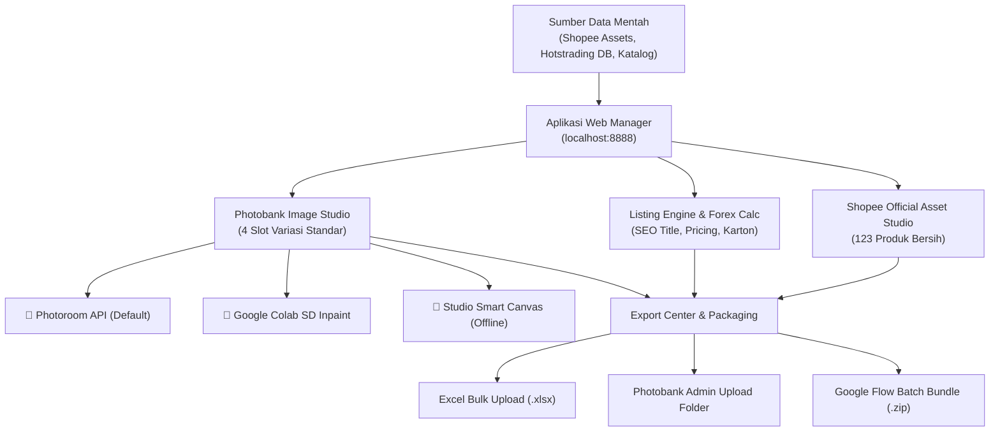
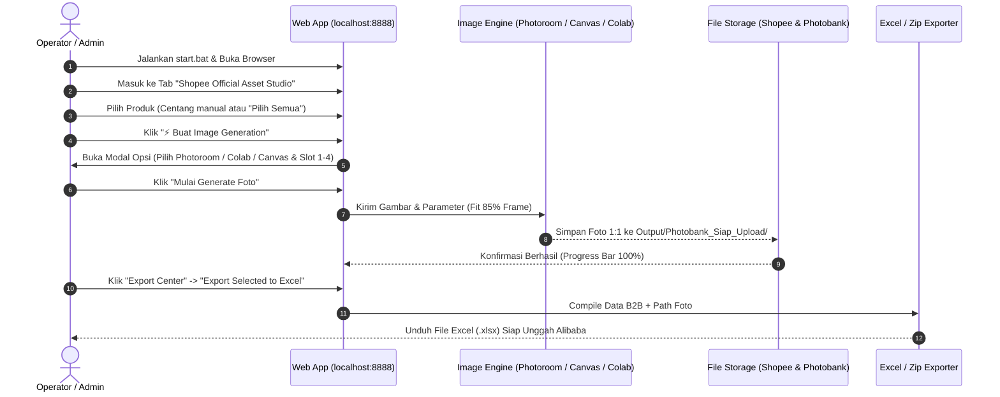

# 🚀 AP BOOTS® Global B2B Catalog Manager
## Panduan Ringkas Fitur, Alur Kerja (Workflow), dan Rencana Tindak Lanjut (TODO)

> **Lokasi File:** `Doc/SYSTEM_OVERVIEW_FEATURES_WORKFLOW_AND_TODO.md`  
> **Aplikasi Utama:** Web App Lokal (`http://localhost:8888`) dijalankan via [`start.bat`](file:///d:/Work/Hots/Product%20Input/start.bat)  
> **Repository:** `alibaba-bulk-hotstrading` (Branch: `master`)  
> **Entitas Hukum:** Manufaktur: **PT Waru Gunung Industri** | Eksportir: **PT Indo Sukses Semesta**

---

## 📌 1. Ikhtisar Sistem (System Overview)

Aplikasi ini adalah **sistem otomasi terpadu end-to-end** untuk mengelola katalog produk AP Boots & Petrova, membersihkan aset visual, menghasilkan variasi foto standar B2B (Photobank), mengoptimasi listing SEO Alibaba B2B (Accio-compliant), serta mengekspor data siap unggah ke berbagai marketplace ekspor.



---

## 🌟 2. Fitur-Fitur Utama (Key Features)

### A. Shopee Official Asset Studio (123 Produk)
- **Katalog Resmi Terverifikasi:** Mengelola 104 SKU AP Boots Official + 19 SKU Petrova Official.
- **Struktur Folder Terstandarisasi:** 1 folder per produk di bawah `Shopee_Product_Assets/<Nama_Produk>/`:
  - `hero_<Nama_Produk>.webp` (Foto utama studio bersih)
  - `<Nama_Produk>.json` (Spesifikasi teknis, harga IDR, material, dimensi)
- **Eliminasi Foto Sekunder Rusak:** Menghapus foto non-produk (foto model/orang, banner promo "PESTAP", kartu nama) dari slot studio agar tidak mencemari katalog B2B.
- **Automated Drag & Drop Dropzone:** Penggantian foto hero secara instan langsung dari kartu produk UI.

---

### B. Photobank 4-Slot Studio & Image Generation Engine
Standar foto B2B Alibaba mengharuskan **4 sudut visual konsisten (rasio 1:1, 1000×1000 px, latar putih murni `#FFFFFF`)**:
1. **Slot 1 (Hero White BG):** Tampak 3/4 depan studio, pencahayaan softbox, tekstur PVC tajam.
2. **Slot 2 (90° Lateral Profile):** Tampak samping horizontal ortogonal menunjukkan tinggi leher boot dan kontur tumit (tanpa model manusia).
3. **Slot 3 (Outsole Tread Detail):** Close-up detail tapak bawah sol dan alur cleat anti-slip.
4. **Slot 4 (Contextual In-Use):** Foto penggunaan aktif di medan kerja (perkebunan sawit, konstruksi, atau pabrik basah).

#### Pilihan Mesin Image Generation:
| Mesin | Kecepatan | Kualitas & Kegunaan | Biaya / API Key |
| :--- | :--- | :--- | :--- |
| **🎨 Photoroom API (Default)** | ⚡ **~3.5 detik** | **Terbaik untuk Slot 1 & 2.** Segmentasi AI presisi, hapus background instan, putih murni `#FFFFFF`, nol halusinasi. | Pro Key: `sk_pr_default_5cf...`<br/>Sandbox: `sandbox_sk_pr_default_...` |
| **🚀 Google Colab Inpainting** | 🕒 **~8–12 detik** | **Terbaik untuk Slot 4.** Menghasilkan latar realistis (lumpur sawit, gudang) menggunakan GPU T4 gratis via pyngrok. | Gratis (Colab Notebook + pyngrok) |
| **📐 Studio Smart Canvas** | ⚡ **0.05 detik** | **100% Offline Lokal.** Cropping bounding box cerdas & upscaling Lanczos ke kanvas putih murni. | Gratis (Native Python/PIL, tanpa kuota) |
| **🔑 Google AI Studio (Imagen 3)** | 🕒 **~5–10 detik** | Generasi visual sintetis fotorealistik baru berbasis prompt teks mendalam. | Google AI Studio Key (`AIzaSy...`) |

> [!TIP]
> **Anti-Kekecilan (`fit_to_studio_canvas`):**  
> Sistem otomatis memangkas margin kosong dan memperbesar objek sepatu secara proporsional hingga mengisi **85% – 88% kanvas (850 px dari 1000 px)** sehingga foto tidak lagi terlihat kecil di tengah.

---

### C. Alibaba B2B Listing Engine & Accio AI Optimizer
- **3-Keyword Title Formula:** Judul mematuhi kaidah SEO Alibaba B2B:  
  `[Target Audience/Application] + [Core Product Keyword] + with [Key Technical Feature/Material]`
- **Live Forex Currency Engine:** Menghitung harga tier B2B otomatis dari rupiah (IDR) ke USD berdasarkan kurs real-time Google Forex.
- **Carton & Packaging Logistics:** Menghitung CBM karton, berat kotor (gross weight), isi per karton (pairs per carton), serta kapasitas muat kontainer 20ft / 40ft HQ.
- **Alibaba 800 Matrix Explorer:** Memetakan 10 sudut industri ekspor (Pertanian, Konstruksi, Medis, Makanan, dsb.) ke dalam 80 negara tujuan pasar global.
- **Audit & Auto-Resolver:** Menganalisis laporan kesalahan unggah (15 laporan gagal) dan memperbaiki judul duplikat serta atribut yang kurang secara otomatis.

---

### D. Export Center & Multi-Platform Packaging
- **Export to Excel (.xlsx):** Format standar kolom Alibaba Bulk Listing (SKU, Title, Category ID, Price Tiers, Weight, CBM, Image URLs).
- **Export to CSV & JSON:** Mendukung integrasi API eksternal dan backup basis data.
- **Google Flow Batch Packager (`buka_flow_10_batch.bat`):**  
  Menghasilkan arsip siap pakai `Output/Flow_10_Products_Assets_HOTS.zip` berisi 40 foto WebP dan 10 file JSON B2B.

---

## 🔄 3. Alur Kerja Standar (Standard Workflow)



### Langkah Operasional Detail:
1. **Buka Aplikasi:**
   - Double-click [`start.bat`](file:///d:/Work/Hots/Product%20Input/start.bat).
   - Akses antarmuka di peramban: `http://localhost:8888`.
2. **Pilih & Tinjau Produk:**
   - Masuk ke tab **Shopee Official Asset Studio**.
   - Gunakan kotak centang pada kartu produk untuk memilih produk yang akan diproses (misal: 10 atau 20 produk).
3. **Eksekusi Image Generation:**
   - Klik tombol **⚡ Buat Image Generation (X Terpilih)**.
   - Pilih mesin: **🎨 Photoroom API Studio** (default tercepat & terbersih).
   - Pastikan preset slot aktif (rekomendasi: **🌟 Semua 4 Slot** atau **📐 Hero & Side Saja**).
   - Klik **Mulai Generate Foto**. Pantau log hingga progres mencapai 100%.
4. **Ekspor Listing Alibaba:**
   - Klik menu **Export Center** di toolbar atas atau bilah bawah.
   - Pilih **☑️ Export Selected to Excel (.xlsx)**.
   - Buka file Excel yang dihasilkan untuk peninjauan akhir.
5. **Unggah ke Marketplace / Photobank:**
   - Foto yang telah digenerate siap diunggah ke Photobank Alibaba (`admin.hotstrading.com/photo-bank`).
   - Unggah file Excel ke Alibaba Seller Center via menu **Bulk Upload Products**.

---

## 📚 4. Panduan Berkas Dokumentasi (`Doc/` Sitemap)

Folder [`d:\Work\Hots\Product Input\Doc`](file:///d:/Work/Hots/Product%20Input/Doc) berisi referensi mendalam yang dikelompokkan sebagai berikut:

| Kategori | Berkas Dokumen | Penjelasan Singkat |
| :--- | :--- | :--- |
| **Arsitektur & Image Generation** | [**`PANDUAN_ARSITEKTUR_DAN_INTEGRASI_IMAGE_GENERATION_PHOTOROOM_COLAB_FLOW.md`**](file:///d:/Work/Hots/Product%20Input/Doc/PANDUAN_ARSITEKTUR_DAN_INTEGRASI_IMAGE_GENERATION_PHOTOROOM_COLAB_FLOW.md) | Panduan lengkap Photoroom API, Colab Inpainting ngrok, Smart Canvas, dan Flow. |
| | [**`SHOPEE_OCTOBER_ASSET_MANAGER_AND_IMAGE_SYSTEM.md`**](file:///d:/Work/Hots/Product%20Input/Doc/SHOPEE_OCTOBER_ASSET_MANAGER_AND_IMAGE_SYSTEM.md) | Standarisasi folder 123 SKU Shopee, hero image, dan JSON. |
| | [**`alibaba-product-photo-guide.md`**](file:///d:/Work/Hots/Product%20Input/Doc/alibaba-product-photo-guide.md) | Aturan resmi ukuran, margin, dan resolusi foto produk Alibaba. |
| **Alibaba Listing & SEO** | [**`ALIBABA_LISTING_GENERATOR_MASTER_PROMPT.md`**](file:///d:/Work/Hots/Product%20Input/Doc/ALIBABA_LISTING_GENERATOR_MASTER_PROMPT.md) | Master prompt Accio AI untuk formulasi judul dan deskripsi B2B. |
| | [**`ANALISIS_ALIBABA_800_LISTING_MATRIX.md`**](file:///d:/Work/Hots/Product%20Input/Doc/ANALISIS_ALIBABA_800_LISTING_MATRIX.md) | Matriks 800 variasi listing (10 angle industri × 80 negara). |
| | [**`PANDUAN_DAN_SPESIFIKASI_BULK_UPLOAD_ALIBABA_2026.md`**](file:///d:/Work/Hots/Product%20Input/Doc/PANDUAN_DAN_SPESIFIKASI_BULK_UPLOAD_ALIBABA_2026.md) | Format kolom Excel bulk upload Alibaba resmi. |
| **Katalog Master** | [**`KATALOG_REFERENSI_PRODUK_MASTER_106_SKU.md`**](file:///d:/Work/Hots/Product%20Input/Doc/KATALOG_REFERENSI_PRODUK_MASTER_106_SKU.md) | Spesifikasi lengkap 106 SKU AP Boots (dimensi, berat, harga). |
| | [**`KATALOG_PRODUK_AP_BOOTS_2026.md`**](file:///d:/Work/Hots/Product%20Input/Doc/KATALOG_PRODUK_AP_BOOTS_2026.md) | Database terperinci seluruh produk AP Boots. |
| | [**`KATALOG_ACUAN_SHOPEE_OKTOBER_2026_MASTER.md`**](file:///d:/Work/Hots/Product%20Input/Doc/KATALOG_ACUAN_SHOPEE_OKTOBER_2026_MASTER.md) | Master data produk AP Boots dari Shopee Official. |
| | [**`KATALOG_ACUAN_SHOPEE_OKTOBER_PETROVA_2026.md`**](file:///d:/Work/Hots/Product%20Input/Doc/KATALOG_ACUAN_SHOPEE_OKTOBER_PETROVA_2026.md) | Master data produk Petrova Official. |
| **Kepatuhan & Hukum (Compliance)** | [**`GPSR_Batch_Compliance_PT_Waru_Gunung.md`**](file:///d:/Work/Hots/Product%20Input/Doc/GPSR_Batch_Compliance_PT_Waru_Gunung.md) | Dokumen kepatuhan regulasi keselamatan produk Uni Eropa (GPSR EU). |
| **Google Flow & MCP** | [**`FLOW_10_PRODUCTS_AGENT_PROMPT.md`**](file:///d:/Work/Hots/Product%20Input/Doc/FLOW_10_PRODUCTS_AGENT_PROMPT.md) | Prompt batch 10 produk untuk Google Flow Agentic Tool. |
| | [**`WORKFLOW_INTEGRASI_GOOGLE_FLOW_DAN_ALIBABA_MANAGER.md`**](file:///d:/Work/Hots/Product%20Input/Doc/WORKFLOW_INTEGRASI_GOOGLE_FLOW_DAN_ALIBABA_MANAGER.md) | Integrasi Google Flow dengan sistem katalog lokal. |
| **Platform Lain (PaDi UMKM)** | [**`PANDUAN_DAN_SPESIFIKASI_BULK_UPLOAD_PADI_UMKM_2026.md`**](file:///d:/Work/Hots/Product%20Input/Doc/PANDUAN_DAN_SPESIFIKASI_BULK_UPLOAD_PADI_UMKM_2026.md) | Format bulk upload untuk portal B2B BUMN PaDi UMKM. |

---

## ✅ 5. Rencana Tindak Lanjut & Daftar Tugas (Actionable Roadmap / TODO)

Berikut adalah status pekerjaan dan hal-hal yang perlu dilakukan selanjutnya (*Something to be done*):

### Status Pekerjaan:
```
[x] Tahap 1: Ingest & Sinkronisasi 123 SKU Shopee Official (Selesai)
[x] Tahap 2: Integrasi Photoroom API & Smart Canvas Scaler 85% Frame (Selesai)
[x] Tahap 3: Pembersihan Foto Model/Iklan Shopee dari Slot 2 (Selesai)
[x] Tahap 4: Stabilisasi JavaScript UI & Penghapusan Error DevTools (Selesai)
[x] Tahap 5: Pembuatan Bundle Batch 10 Flow (Selesai)
[ ] Tahap 6: Generate Foto Lengkap 4-Slot untuk Flagship 40 Produk (Siap Eksekusi)
[ ] Tahap 7: Jalankan Google Colab ngrok untuk Inpainting Slot 4 Medan Nyata (Opsional)
[ ] Tahap 8: Upload Bulk Foto ke Photobank Alibaba & Ekspor Final Excel (Menunggu Jadwal Upload)
```

### 📋 Checklist Tindakan Berikutnya (What to Do Next):

1. **Jalankan Batch Generation untuk Flagship 40 Produk:**
   - Buka `http://localhost:8888`, pilih tab **Shopee Official Asset Studio**.
   - Gunakan filter atau pilih 40 produk unggulan (Flagship 40).
   - Jalankan **Photoroom API Studio** untuk menghasilkan foto Slot 1 (Hero) dan Slot 2 (Side Profile) resolusi tinggi dan bebas watermark.
2. **Eksplorasi Inpainting Slot 4 via Google Colab:**
   - Buka notebook: [Google Colab Inpainting](https://colab.research.google.com/drive/1Vnoy0QT1gzMCPwsif1yheAslk6tUHUv4?usp=sharing).
   - Aktifkan runtime GPU T4 dan jalankan server pyngrok.
   - Masukkan link ngrok (`https://....ngrok-free.app/generate-background/`) ke opsi modal Web App untuk menghasilkan variasi pemakaian di perkebunan/pabrik pada Slot 4.
3. **Sinkronisasi Folder Photobank Siap Unggah:**
   - Periksa folder [`Output/Photobank_Siap_Upload/`](file:///d:/Work/Hots/Product%20Input/Output/Photobank_Siap_Upload).
   - Pastikan 8 sub-kategori (`01_Safety_Boots`, `02_Agriculture_Plantation`, dst.) terisi foto-foto format `.webp` dengan penamaan terstandarisasi.
4. **Unggah Massal Listing Alibaba:**
   - Lakukan ekspor Excel dari menu **Export Center** -> **Export Flagship 40 to Excel**.
   - Lakukan upload file `.xlsx` tersebut di **Alibaba Seller Center** -> **Manage Products** -> **Batch Upload**.
