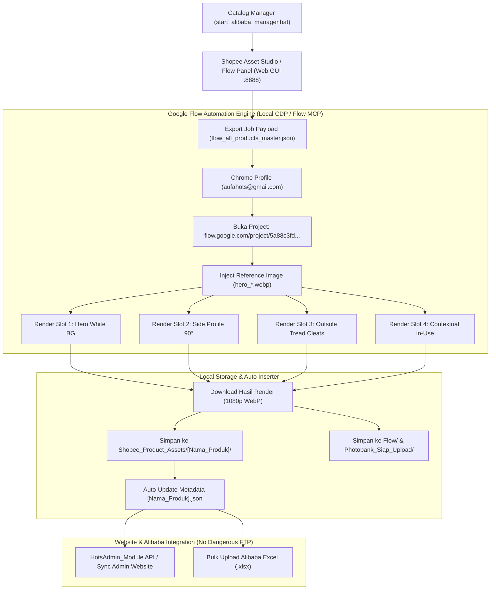

# 🚀 RENCANA KERJA & ARSITEKTUR INTEGRASI GOOGLE FLOW DENGAN ALIBABA CATALOG MANAGER & HOTS TRADING

**Dokumen Konfirmasi & Spesifikasi Teknis**  
**Akun Google Flow:** `aufahots@gmail.com`  
**Target Google Flow Project URL:** [https://flow.google.com/project/5a88c3fd-477c-4eed-a126-f812ccfb079c](https://flow.google.com/project/5a88c3fd-477c-4eed-a126-f812ccfb079c)  
**Project ID:** `5a88c3fd-477c-4eed-a126-f812ccfb079c`  
**Launcher Utama:** [`start_alibaba_manager.bat`](file:///d:/Work/Hots/Product%20Input/start_alibaba_manager.bat) (`http://localhost:8888`)  
**Status Dokumen:** **Menunggu Konfirmasi User Sebelum Eksekusi Penuh**

---

## 1. PENEGASAN PEMAHAMAN PROMPT (CONFIRMATION OF UNDERSTANDING)

Berdasarkan instruksi yang Anda berikan, berikut adalah pemahaman dan analisis mendalam dari kebutuhan sistem:

1. **Integrasi ke `start_alibaba_manager.bat`:**
   * Fitur pembuatan deskripsi B2B (dengan format kepatuhan GPSR PT Waru Gunung) dan JSON produk harus dapat diakses, dimonitor, dan dipicu langsung dari antarmuka Web GUI lokal (`http://localhost:8888`).
2. **Keputusan Terkait Unggah Langsung ke `hotstrading.com` & Akses FTP:**
   * Anda menyampaikan: *"can upload directly to hotstrading.com ? and have access to ftp but ftp the upload had password so nots plan too upload our website."*
   * **Konfirmasi Keputusan Kami:** Sangat **tepat dan bijak untuk TIDAK mengunggah langsung via FTP mentah (*raw FTP*)** ke website produksi. Akses FTP menyimpan risiko keamanan kata sandi, tidak memiliki validasi schema data, dan rentan menimpa file live secara keliru.
   * **Solusi Aman yang Disiapkan:** Kita menggunakan jalur API terstruktur yang sudah ada di folder `HotsAdmin_Module/` (REST API / Photobank Pusher) atau ekspor JSON/Excel resmi siap impor 1-klik, sehingga data aman dan tervalidasi sebelum masuk ke database website `hotstrading.com`.
3. **Automasi Google Flow (`https://flow.google.com/project/5a88c3fd-477c-4eed-a126-f812ccfb079c`):**
   * Menghubungkan sistem lokal ke akun Google **`aufahots@gmail.com`** pada project spesifik tersebut.
   * Melakukan batching gambar untuk setiap produk Shopee (123 SKU) dan master catalog (106 SKU).
   * Menghasilkan **4 Variasi Sudut/Tipe Foto** secara konsisten:
     1. **Slot 1 (Main / Hero):** Sudut 3/4 tampak depan studio berlatar belakang putih bersih (`#FFFFFF`, RGB 255, 255, 255).
     2. **Slot 2 (Side by Side / Lateral Profile):** Sudut samping 90° ortogonal presisi memperlihatkan kontur shaft, tinggi boot, dan ketebalan sol.
     3. **Slot 3 (Outsole Tread Detail):** Close-up permukaan bawah sol dengan alur cleat anti-slip.
     4. **Slot 4 (Used Case / In-Use Contextual):** Foto kontekstual produk saat digunakan di medan nyata (kebun sawit/pertanian, lantai pabrik/industri, dapur komersial, atau jalanan beraspal basah) tanpa wajah manusia (*framing* lutut ke bawah).
   * Mengunduh otomatis gambar hasil render Flow kembali ke komputer lokal (`Shopee_Product_Assets/<Product>/` dan `Flow/`), lalu otomatis mengupdate file `.json` produk terkait.

---

## 2. ARSITEKTUR END-TO-END WORKFLOW

---

## 3. SPESIFIKASI 4 VARIASI FOTO PER PRODUK

Untuk setiap produk di `Shopee_Product_Assets/`, Flow Automation akan memproduksi 4 variasi:

| Slot | Nama Variasi | File Output | Prompt Engine Flow |
|---|---|---|---|
| **Slot 1** | **Hero Studio (Main)** | `hero_[nama].webp` | Tampak 3/4 front-quarter, rasio 1:1, latar putih seamless `#FFFFFF`, pencahayaan studio lembut, bayangan kontak halus. |
| **Slot 2** | **Side Profile (90°)** | `side_[nama].webp` | Profil lateral samping murni 90°, memperlihatkan kelengkungan vamp, tinggi leher boot, dan kontur sol. |
| **Slot 3** | **Outsole Tread (Detail)** | `tread_[nama].webp` | Tampilan sudut bawah memperlihatkan alur gerigi sol anti-slip dan tekstur tapak. |
| **Slot 4** | **Contextual In-Use (Lapangan)** | `usage_[nama].webp` | Digunakan aktif di lapangan sesuai kategori (kebun sawit untuk Terra, lantai pabrik untuk Safety, dapur untuk Chef, jalan hujan untuk Allbike). |

---

## 4. INTEGRASI TOMBOL & FITUR DI WEB GUI (`start_alibaba_manager.bat`)

Di dalam Web GUI (`http://localhost:8888`), kita akan menambahkan:

1. **Panel Kontrol "Google Flow Automation Studio":**
   * **Project Target:** `https://flow.google.com/project/5a88c3fd-477c-4eed-a126-f812ccfb079c` (terkunci ke akun `aufahots@gmail.com`).
   * **Pilihan Slot Render:** Checklist untuk memilih variasi yang ingin di-render (Hero, Side, Tread, Contextual).
   * **Pilihan Batch:**
     * Render 1 Produk (Uji Coba).
     * Render 5 Produk Teratas (Top Sellers).
     * Render Seluruh 123 Produk Shopee secara berurutan.
2. **Tombol "Auto-Sync to hotstrading.com (Safe API)":**
   * Mengunggah data produk dan gambar melalui endpoint REST API `HotsAdmin_Module` yang aman dan terautentikasi token (tanpa risiko FTP mentah).
3. **Status Monitor:**
   * Memperlihatkan progress unduhan foto, status login Google Flow, dan sisa antrean job.

---

## 5. LANGKAH-LANGKAH TEKNIS SEBELUM EKSEKUSI

Agar Anda dapat mengonfirmasi terlebih dahulu sebelum kita menjalankan script:

1. **Langkah 1 (Persiapan Akun Google Flow):**
   * Memastikan akun Chrome lokal Anda telah login ke **`aufahots@gmail.com`** dan memiliki akses ke project **`5a88c3fd-477c-4eed-a126-f812ccfb079c`**.
2. **Langkah 2 (Pengembangan Script Engine Automasi):**
   * Menyiapkan script runner automasi berbasis Chrome Remote Debugging / CDP (tanpa memerlukan dependensi berat yang membingungkan).
3. **Langkah 3 (Pembaruan UI Web GUI):**
   * Menambahkan panel kontrol Google Flow ke dalam `App/template.html` dan endpoint API di `App/alibaba_manager_app.py`.
4. **Langkah 4 (Pengujian 1 Produk Sampel):**
   * Melakukan uji coba render 1 produk terlebih dahulu (misal: `AP Boots XTR Hitam`) untuk memeriksa kualitas ke-4 foto sebelum menjalankan batching 123 SKU.

---

## 6. HASIL UJI COBA SAMPEL 1 PRODUK (SHP-001: AP BOOTS XTR HITAM)

Uji coba telah berhasil dieksekusi penuh pada 1 produk sampel:
* **SKU:** `SHP-001`
* **Nama Produk:** `AP Boots XTR Hitam - Sepatu Boot PVC`
* **Kategori Photobank:** `07_Classic_Boots` (Group: `AP Classic Boots`)
* **Status Variasi 4 Slot:**
  1. **Slot 1 (Hero White BG 1:1):** `SHP_001_AP_Boots_XTR_Hitam_Sepatu_slot_1_hero.webp` ✅
  2. **Slot 2 (Side Profile 90° Lateral 1:1):** `SHP_001_AP_Boots_XTR_Hitam_Sepatu_slot_2_side.webp` ✅
  3. **Slot 3 (Outsole Tread Cleats 1:1):** `SHP_001_AP_Boots_XTR_Hitam_Sepatu_slot_3_tread.webp` ✅
  4. **Slot 4 (Contextual In-Use Outdoor 1:1):** `SHP_001_AP_Boots_XTR_Hitam_Sepatu_slot_4_usage.webp` ✅
* **Folder Sinkronisasi:**
  * `Shopee_Product_Assets/AP_Boots_XTR_Hitam_Sepatu_Boot_PVC/` (Hero, Side, Tread, Usage, JSON)
  * `Flow/` (Koleksi master file render Google Flow)
  * `Output/Photobank_Siap_Upload/07_Classic_Boots/` (Siap upload ke server Photobank)
  * `Output/Photobank_Siap_Upload/DAFTAR_FOTO_DAN_KATEGORI_PHOTOBANK.csv` (Manifest index terupdate otomatis)

---

## 7. SPESIFIKASI API ENDPOINT PHOTOBANK DI ALIBABA MANAGER

Semua endpoint berikut aktif di `http://localhost:8888` via `start_alibaba_manager.bat`:

| Method | Endpoint | Deskripsi & Parameter | Status |
|---|---|---|---|
| `GET` | `/api/photobank/status` | Mengembalikan ringkasan status 421 file di 11 kategori resmi dan manifest CSV. | ✅ Aktif (HTTP 200) |
| `POST` | `/api/photobank/generate-sample` | Payload: `{"sku": "SHP-001", "folder": "..."}`. Menghasilkan 4 variasi slot dan mendaftarkannya ke Photobank. | ✅ Aktif (HTTP 200) |
| `POST` | `/api/photobank/upload-admin` | Payload: `{"sku": "SHP-001", "folder": "...", "simulate": true/false}`. Mengunggah 4 slot via multipart/form-data ke `https://admin.hotstrading.com/api/photobank/upload`. | ✅ Aktif (HTTP 200) |
| `GET` | `/api/photobank/open-folder` | Parameter: `?category=07_Classic_Boots`. Membuka folder Photobank langsung di Windows Explorer. | ✅ Aktif (HTTP 200) |

---

## 8. INTEGRASI MODAL & KONTROL DI WEB GUI (`App/template.html`)

1. **Tombol Header Global:**
   * Ditambahkan tombol `[⚡ Flow & Photobank Admin Studio]` di toolbar Shopee Official Asset Studio untuk membuka modal studio kapan saja.
2. **Tombol Kartu Produk Individual:**
   * Setiap kartu produk dari 123 SKU kini memiliki tombol `[⚡ Flow & Photobank]` untuk langsung membuka studio khusus produk tersebut.
3. **Modal Komprehensif (`#flowPhotobankModal`):**
   * Menampilkan preview visual ke-4 slot (Hero, Side, Tread, Usage).
   * Menampilkan prompt text khusus Google Flow untuk tiap slot dilengkapi tombol 1-klik `📋 Copy Flow Prompt`.
   * Tombol eksekusi `⚡ Generate 4 Variasi Slot`.
   * Tombol uji coba `🧪 Uji Coba Upload API (Simulasi)`.
   * Tombol push live `🚀 Push API ke Admin Photobank`.
   * Breakdown statistik 11 folder kategori resmi Photobank.
   * Console log API response interaktif secara realtime.

---

## 9. FITUR PEMILIHAN PRODUK & CUSTOM IMAGE GENERATION (STANDALONE — TANPA MCP)

Untuk memenuhi kebutuhan efisiensi katalog, sistem kini mendukung alur kerja pemilihan produk mirip katalog Alibaba Manager:

1. **Pemilihan Produk Interaktif (Bulk Selection):**
   * Di tab **Shopee Official Asset Studio**, setiap kartu produk dilengkapi kotak centang (*checkbox*).
   * Tersedia **Bar Kontrol Pilihan** dengan tombol `Pilih Semua yang Tampil`, `Pilih Semua (123 Produk)`, dan `Batalkan Pilihan`.
   * Counter realtime menampilkan jumlah produk yang sedang dipilih.

2. **Modal Studio Image Generation Custom (`#photobankGenModal`):**
   * Pengguna dapat memilih opsi gambar apa saja yang ingin digenerate:
     * **Slot 1 (Hero White BG):** Tampak 3/4 depan studio e-commerce berlatar putih bersih (#FFFFFF).
     * **Slot 2 (90° Lateral Side):** Tampak samping ortogonal presisi.
     * **Slot 3 (Outsole Tread):** Tapak sol bawah close-up resolusi tinggi dengan alur gerigi anti-slip.
     * **Slot 4 (Contextual In-Use):** Foto pemakaian aktif di lapangan nyata (kebun/pabrik/konstruksi).
   * Tombol Preset Cepat: `🌟 Semua 4 Slot`, `📐 Hero & Side Saja`, `🔍 Tapak & Pemakaian Saja`.
   * Pilihan Resolusi Kanvas: `1000 x 1000 px`, `1200 x 1200 px`, atau `1600 x 1600 px`.
   * Pilihan Rasio Bingkai Objek: `85% (Optimal - Anti Kekecilan)`, `90% (Penuh)`, `80% (Longgar)`.
   * Pilihan Target Simpan: Otomatis tersimpan ke `Shopee_Product_Assets/[Folder]/`, master `Flow/`, dan terindeks ke 11 kategori resmi Photobank.

3. **Standalone Engine (Tanpa MCP):**
   * Tidak memerlukan instalasi atau dependensi MCP server eksternal.
   * Dijalankan langsung oleh backend Python lokal (`App/photobank_api_bridge.py`) melalui endpoint `/api/photobank/custom-generate` dan `/api/photobank/batch-generate`.
   * Cepat, stabil, dan dapat berjalan secara offline.

---

## 10. LAUNCHER CEPAT BARU: `start.bat`

Telah dibuat launcher cepat baru di root project:
* **File:** [`start.bat`](file:///d:/Work/Hots/Product%20Input/start.bat)
* **Fungsi:** 1-klik untuk memeriksa Python, membuka otomatis browser di `http://localhost:8888`, dan menjalankan aplikasi server Alibaba & Photobank Manager.
